# Ejercicio 1: creadores y campañas

Resultados de las configuraciones de `configs/`. Kohonen y Oja se repiten con 30 semillas, de 42 a 71; se informa media ± desvío estándar muestral (DE). Las grillas individuales son ejemplos de la semilla 42. Las [referencias teóricas](../referencias-teoricas.md) detallan las fuentes y convenciones de cada método.

## 1.1 Exploración y representación

Hay **50 creadores, 33 columnas y ninguna celda faltante**: dos identificadores y 31 variables numéricas. Los nombres identifican filas; los tópicos se obtienen de las columnas del catálogo.

Las distribuciones, boxplots y correlaciones muestran diferencias de escala importantes y variables derivadas de otras. Los boxplots marcan 33 celdas en 25 creadores usando bigotes de 1,5 RIC. Se conservan todos los creadores: los valores atípicos describen perfiles extremos y por sí solos no demuestran errores de datos.

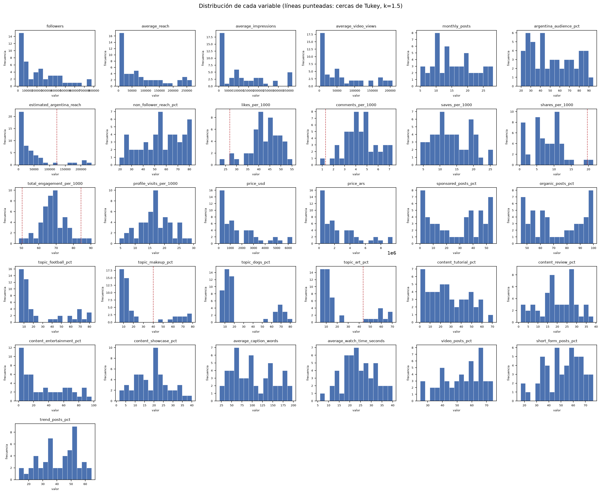

Se seleccionan **27 variables**. Se mantienen los cuatro tópicos y los cuatro tipos de contenido completos para tratarlos simétricamente en las distancias. Las proporciones que suman 100 son dependientes; PCA admite esa dependencia.

| Columna excluida del entrenamiento | Motivo y representación conservada |
|---|---|
| `price_ars` | Conversión fija del precio USD: no contar dos veces el mismo precio |
| `total_engagement_per_1000` | Suma de likes, comentarios, guardados y compartidos, que se conservan separados |
| `estimated_argentina_reach` | Agregado calculado de alcance y porcentaje argentino, conservados por separado; el agregado sigue disponible para interpretar |
| `organic_posts_pct` | Complemento del porcentaje patrocinado; se mantiene este último |

Esta representación modifica el peso relativo de las familias de variables. Cambiar columnas o pesos requiere repetir el análisis.

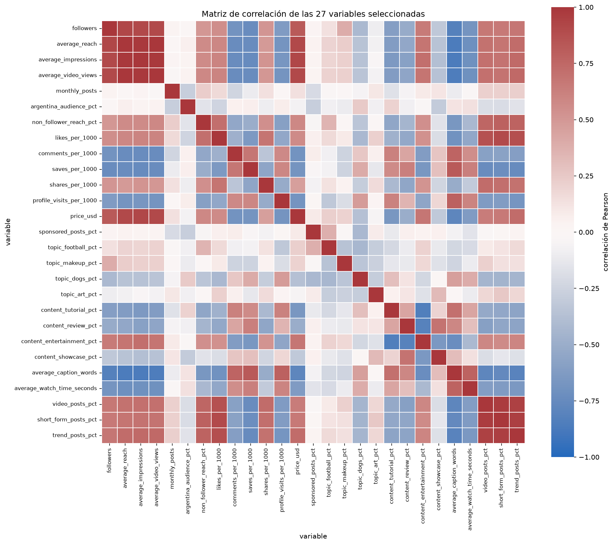

**PCA y escala.** Sin estandarizar, PC1 explica 96,0% y su mayor coeficiente corresponde a seguidores: predominan las unidades de medición. Con media cero y desvío uno:

| Cantidad | Resultado |
|---|---:|
| Varianza de PC1 | 49,7% |
| Varianza de PC2 | 9,2% |
| PC1 + PC2 | 58,9% |
| Componentes para acumular 80% | 6 |
| Componentes para acumular 90% | 10 |

80% y 90% son referencias descriptivas de varianza acumulada. Se conservan las 27 variables estandarizadas para Kohonen y Oja: el biplot de dos componentes pierde 41,1% de la varianza y el enunciado pide agrupar según el conjunto de variables. PCA se utiliza para interpretar y contrastar la representación.

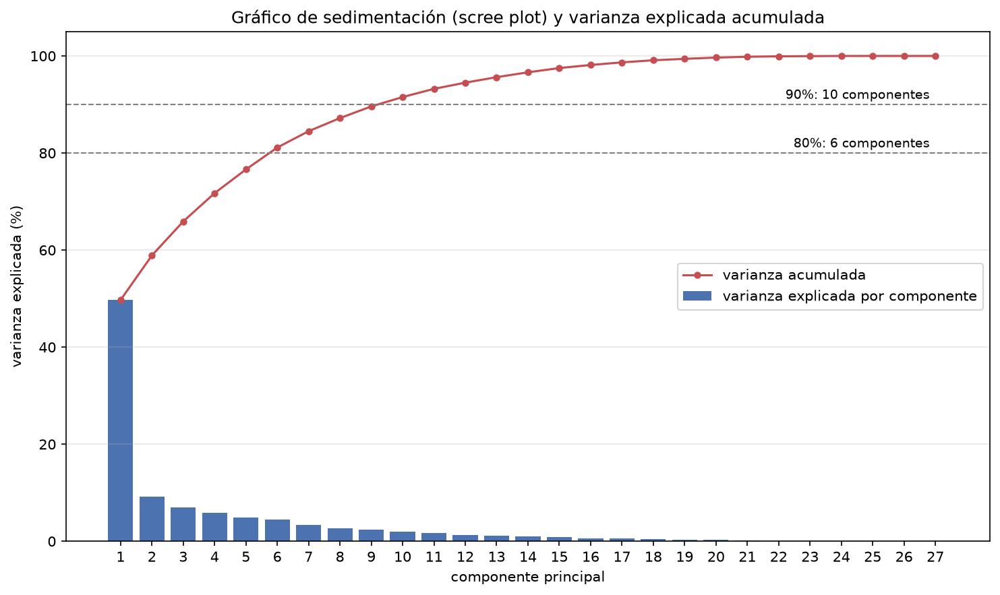

**Interpretación.** Con la convención de signo documentada, PC1 contrapone epígrafes largos y perfiles con mayor profundidad de interacción frente a grandes volúmenes de alcance, impresiones, video y tendencias. Las mayores cargas son `average_caption_words` +0,256; `average_impressions` −0,251; `average_video_views` −0,249; `average_reach` −0,248 y `trend_posts_pct` −0,246. No representa «calidad» ni retorno comercial.

PC2 contrapone principalmente showcase (+0,419) y arte (+0,401) frente a porcentaje de audiencia argentina (−0,361) y perros (−0,261). Combina estilo, temática y audiencia. El signo de cualquier componente se puede invertir sin cambiar el análisis.

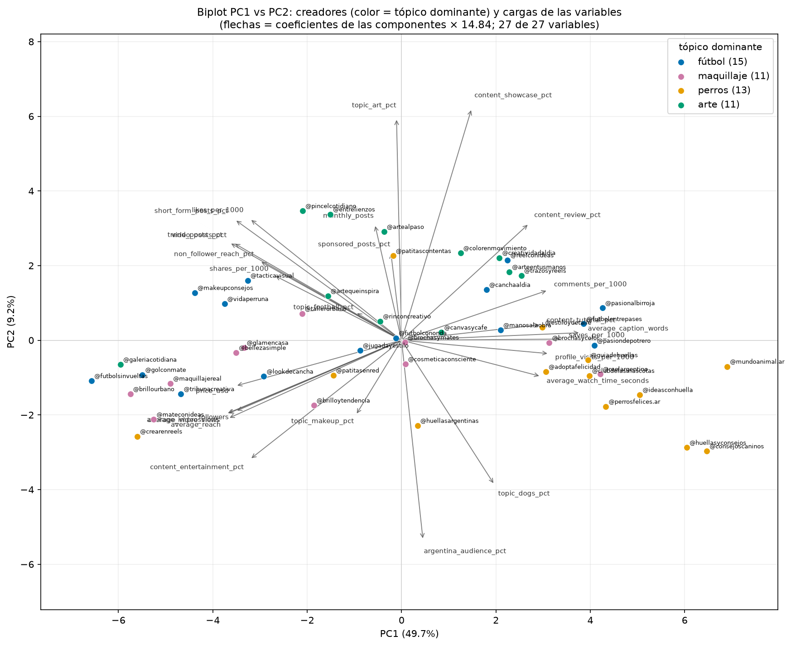

Evidencia: `runs/eda/{columns,outliers,identities,correlation}.csv`, `runs/pca/{explained_variance,loadings,scores}.csv` y el control `runs/pca_scaling_sweep/`.

## 1.2 Kohonen: implementación, comparación y elección

Se implementan la ganadora por distancia euclídea y la actualización `w += η(x−w)` para la ganadora y sus vecinas dentro del radio. Se usa vecindad binaria y η(i)=η₀/(1+i), contando cada presentación desde i=0. Los nombres y tópicos dominantes no intervienen en el entrenamiento.

Se realizan seis barridos, cambiando **un solo hiperparámetro por vez** respecto de la base: 4×4 hexagonal, inicialización con muestras, η₀=0,9, radio constante 1 y 200 épocas. Cada punto usa las mismas 30 semillas. Para estudiar el tamaño, un único parámetro k define la grilla cuadrada k×k.

| Parámetro variado | Valor | Distancia a ganadora | Neuronas vacías | U media |
|---|---|---:|---:|---:|
| Lado de grilla | 3×3 | 3,683 ± 0,045 | 0,10 ± 0,31 | 2,141 ± 0,076 |
| Lado de grilla | 4×4 | 3,458 ± 0,070 | 0,90 ± 0,88 | 2,108 ± 0,193 |
| Lado de grilla | 5×5 | 3,273 ± 0,069 | 3,23 ± 1,30 | 2,281 ± 0,133 |
| Lado de grilla | 6×6 | 3,002 ± 0,098 | 8,53 ± 1,98 | 2,629 ± 0,195 |
| η inicial | 0,1 | 3,072 ± 0,081 | 0,00 ± 0,00 | 5,307 ± 0,343 |
| η inicial | 0,5 | 3,479 ± 0,089 | 1,03 ± 0,76 | 2,403 ± 0,158 |
| η inicial | 0,9 | 3,458 ± 0,070 | 0,90 ± 0,88 | 2,108 ± 0,193 |
| Radio constante | 1 | 3,458 ± 0,070 | 0,90 ± 0,88 | 2,108 ± 0,193 |
| Radio constante | 2 | 3,694 ± 0,047 | 2,97 ± 1,25 | 1,478 ± 0,084 |
| Radio constante | 3 | 3,945 ± 0,014 | 5,47 ± 0,86 | 1,033 ± 0,049 |
| Épocas | 50 | 3,469 ± 0,079 | 0,97 ± 0,72 | 2,163 ± 0,205 |
| Épocas | 200 | 3,458 ± 0,070 | 0,90 ± 0,88 | 2,108 ± 0,193 |
| Topología | hexagonal | 3,458 ± 0,070 | 0,90 ± 0,88 | 2,108 ± 0,193 |
| Topología | rectangular | 3,391 ± 0,052 | 1,27 ± 0,94 | 2,503 ± 0,204 |
| Inicialización | muestras | 3,458 ± 0,070 | 0,90 ± 0,88 | 2,108 ± 0,193 |
| Inicialización | uniforme | 3,581 ± 0,070 | 3,80 ± 1,54 | 2,715 ± 0,404 |

Cada comparación dentro de un barrido mantiene el resto de parámetros fijo. Las filas que coinciden con la base aparecen en varios barridos como referencia; no se combinan como repeticiones adicionales. Las tablas completas están en `runs/som_sweep/comparison.csv` y `runs/som_design_sweep/comparison.csv`.

La elección final mantiene **4×4 hexagonal, muestras, η₀=0,9, radio constante 1 y 200 épocas**. Con η₀=0,1 la red aproxima mejor las entradas, pero los vecinos quedan mucho más separados. Frente a η₀=0,5, η₀=0,9 reduce la U media y obtiene distancias y ocupación comparables. Aumentar el radio a 2 o 3 acerca los prototipos entre sí, pero empeora la aproximación y deja más neuronas vacías. U baja por sí sola no demuestra un mapa útil.

La grilla 3×3 agrega más perfiles por celda; las mayores reducen distancia al ganador a costa de más celdas vacías y menor agregación. La rectangular aproxima mejor las entradas, mientras la hexagonal tiene menor U media y menos vacías en este barrido. La elección es un compromiso descriptivo, sin afirmar un óptimo ni significación estadística.

Para la configuración elegida, la distancia media es **3,458 ± 0,070**, las vacías **0,90 ± 0,88 de 16** y la U media **2,108 ± 0,193** entre entrenamientos. Las barras de los gráficos muestran esta variación entre semillas, condicionada al mismo catálogo de 50 creadores.

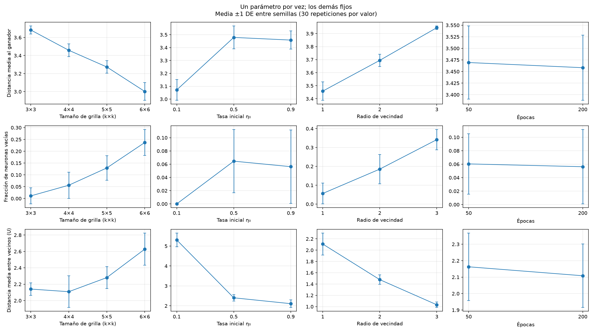

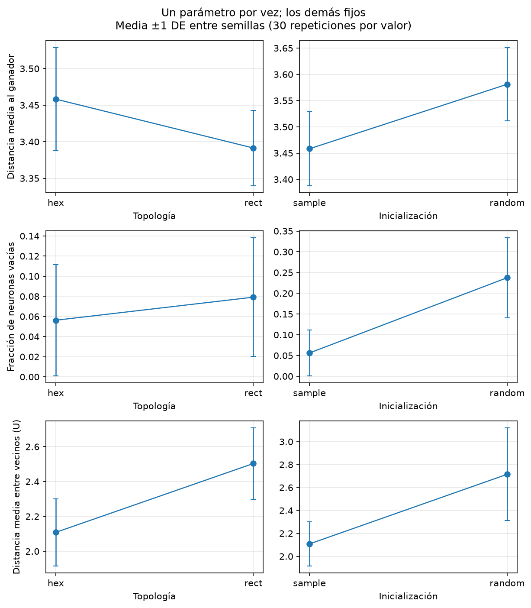

Con η₀=0,9, pasar de 50 a 200 épocas cambia la distancia en −0,0111 ± 0,0173 y la U media en −0,0543 ± 0,0318, calculando la diferencia entre las mismas semillas. Las mejoras son descriptivas; la distancia no es una función de pérdida que deba bajar monótonamente con cada actualización vecinal.
**Grilla e interpretación.** En el ejemplo de la semilla 42 las 16 neuronas reciben creadores; la más ocupada recibe 10. Esa ocupación completa corresponde al ejemplo, mientras la variación entre entrenamientos se informa arriba. Las celdas son los grupos del SOM y sus índices comienzan en cero.

| Celda del ejemplo | Creadores | Perfil real medio y relación con PCA |
|---|---:|---|
| BMU 5 = (1,1) | 10 | 28.844 seguidores, USD 206 por publicación, 46,92% tutorial; PC1 media +4,83 |
| BMU 13 = (3,1) | 9 | 548.380 seguidores, USD 3.981, 10,71% tutorial; PC1 media −5,01 |
| BMU 1 = (0,1) | 2 | 54,47% arte; PC2 media +1,78 |

Las dos primeras celdas reflejan el contraste entre profundidad y volumen de PC1; la tercera incluye perfiles artísticos de PC2. El biplot omite el resto de componentes, por lo que dos puntos cercanos allí pueden caer en celdas distintas. Las coordenadas y orientaciones del mapa cambian entre semillas; se comparan sus métricas globales, sin promediar celdas que no están alineadas.

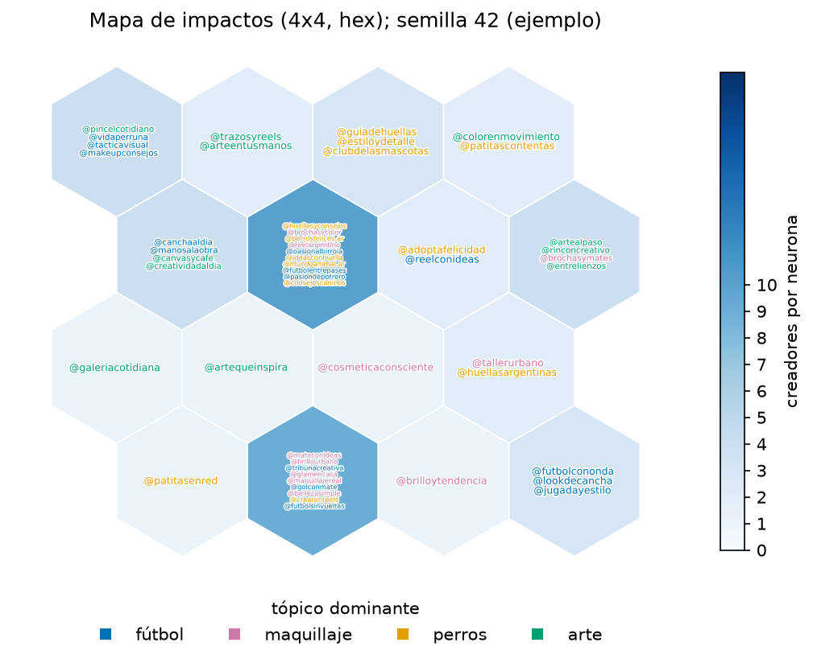

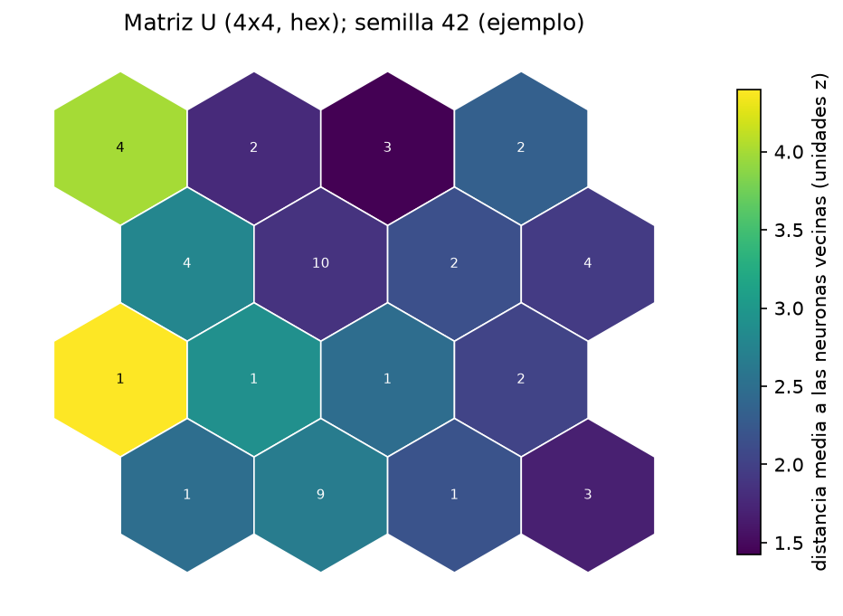

La matriz U representa para cada neurona la distancia media de su prototipo a los prototipos vecinos. Un valor alto marca una transición de perfiles; un valor bajo indica prototipos próximos. En el ejemplo de la semilla 42, U media es 2,4437 y la mayor media por neurona es 4,3951. La arista individual más distante une BMU 4 y 8, con distancia 5,8384; destacan compartidos, entretenimiento y reseñas. La media por neurona y la distancia de una arista son magnitudes diferentes.

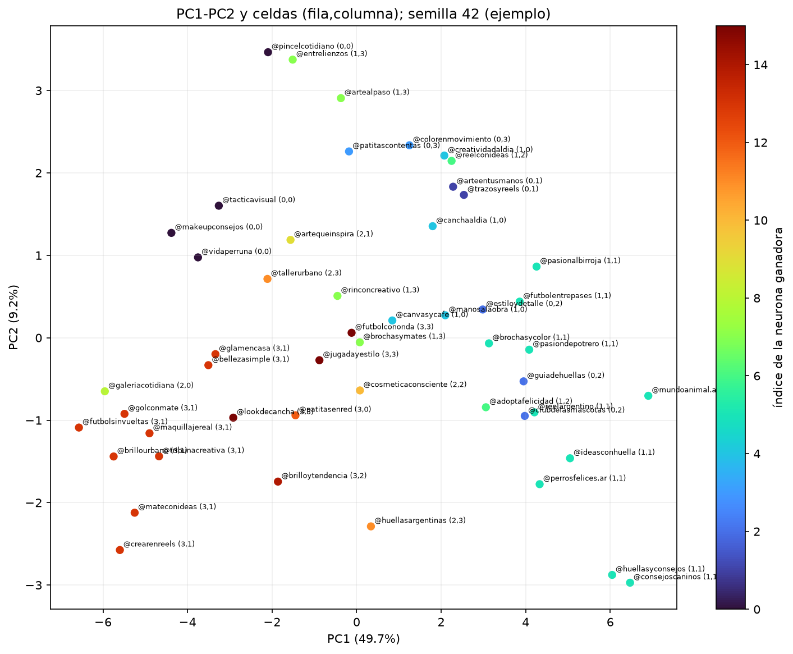

Evidencia: `runs/som/{bmus,neurons,creator_profiles,prototypes,u_edges,history}.csv`, mapas de variables y componentes. Los perfiles tabulados son medias de creadores asignados; los prototipos son los pesos de la red y no tienen por qué coincidir con esas medias.

## 1.3 Oja: índice y comparación con PC1

Una neurona aplica `Δw = η·y·(x−y·w)`, con `y=w·x`, pesos iniciales uniformes en [0,1], η=0,001 y 200 épocas sobre las mismas 27 variables estandarizadas. PC1 se utiliza para comparar el resultado, sin intervenir en la actualización ni en la parada.

Se entrenan **30 neuronas independientes**, con distinta inicialización y orden de ejemplos (semillas 42 a 71). Ninguna diverge. La norma final media es **1,003348 ± 0,000050**, el coseno absoluto con PC1 **0,999891 ± 0,000039** y la correlación de puntajes **0,999990 ± 0,000005**. El cambio final de pesos es **0,01460 ± 0,00357**: con η constante continúa variando.

Las curvas, coeficientes e índices presentan media ± DE entre semillas. Cada vector se normaliza y alinea con PC1 solo al informar, para que los signos opuestos de un mismo eje no se cancelen al promediar. La norma entra en la banda ±0,01 desde la época **5,97 ± 0,81** en promedio; esto describe su norma, no asegura convergencia de dirección en esa época.

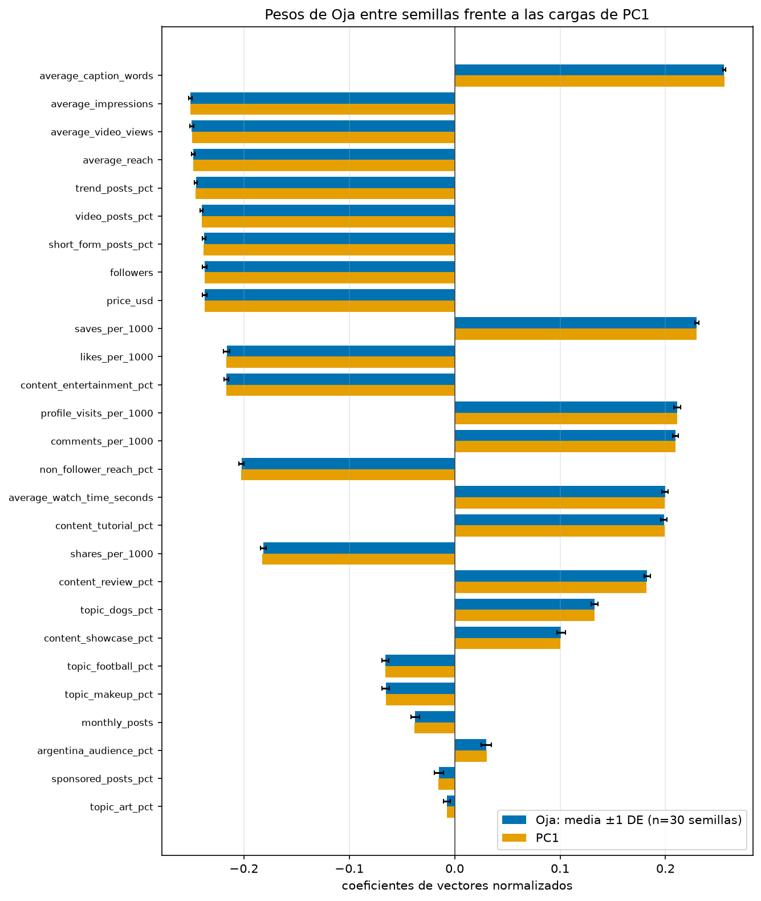

El índice es la proyección sobre el vector aprendido, normalizado y orientado para informar. Los mismos cinco creadores aparecen en el top 5 en las 30 semillas: @mundoanimal.ar, @consejoscaninos, @huellasyconsejos, @ideasconhuella y @perrosfelices.ar. Refleja el eje predominante de variación descrito por PC1. No mide calidad universal: maximizarlo seleccionaría un estilo y, con esta base, favorecería ciertos tópicos. Invertir el signo invertiría el ranking sin cambiar la componente. No es correcto elegir automáticamente el máximo para toda campaña.

Evidencia: `runs/oja/repeats.csv`, `history_stats.csv`, `weights_stats.csv` e `index_stats.csv`; las tablas detalladas de la semilla 42 se conservan como ejemplo.

## 1.4 Decisiones para las cuatro campañas

El SOM permite reconocer familias de perfiles y PCA/Oja interpretar sus diferencias. La decisión comercial requiere elegir un objetivo. Se asume una publicación por creador, tres creadores por campaña y al menos 40% de contenido del tópico. Estos supuestos definen la decisión comercial. Después del filtro se ordena por **una variable observada**. La evidencia conjunta se conserva en `runs/campaigns/evidence.csv`.

| Campaña | Objetivo supuesto y criterio observado | Selección |
|---|---|---|
| Refugios de perros | Facilitar consultas; priorizar visitas al perfil por 1000 | @mundoanimal.ar, @ideasconhuella, @adoptafelicidad |
| Ropa de fútbol | Explicar uso/entrenamiento; priorizar guardados por 1000 | @pasionalbirroja, @futbolentrepases, @pasiondepotrero |
| Belleza | Mostrar procedimientos; priorizar proporción de tutoriales | @reelargentino, @cosmeticaconsciente, @brochasymates |
| Materiales de arte | Enseñar usos; priorizar proporción de tutoriales | @colorenmovimiento, @creatividadaldia, @arteentusmanos |

**Vínculo con los modelos.** En el mapa de ejemplo, dos elegidos para perros caen en BMU 5 y uno en BMU 6; los tres de fútbol caen en BMU 5 y tienen PC1 positiva, consistente con profundidad. Belleza combina BMU 5, 10 y 7: @cosmeticaconsciente tiene 383.128 seguidores y PC1 próxima a cero, pese a su alto porcentaje de tutoriales. Arte reúne BMU 3, 4 y 1, con PC2 positiva. Son observaciones sobre la grilla de la semilla 42, no etiquetas comerciales permanentes.

**Fútbol: alcance, descubrimiento o profundidad.** Para explicar ropa de entrenamiento se prioriza profundidad. Los candidatos de BMU 5 tienen 42,77% de tutoriales y 19,93 guardados/1000; los de BMU 13 tienen 7,22% y 7,01, pero mayor volumen y 71,46% de alcance a no seguidores. BMU 0 presenta 76,45% de alcance a no seguidores, con 27,19% de audiencia argentina. Para reconocimiento de marca podría elegirse otro perfil. Las cifras comerciales describen el catálogo fijo y las reglas elegidas; no tienen barras entre semillas porque la selección comercial es determinista. El catálogo no incluye ventas, conversiones ni adopciones para contrastar rentabilidad.

**Comparación con seguidores.** La estrategia global elige siempre @mateconideas, @golconmate y @brillourbano. También se compara con seguidores dentro del tópico, para distinguir la mejora por filtrar tema de la decisión de privilegiar profundidad.

| Campaña | Tópico medio: decisión / seguidores global / seguidores del tópico | USD total: decisión / seguidores del tópico |
|---|---|---|
| Perros | 64,83% / 9,48% / 66,04% | 683,23 / 6.992,95 |
| Fútbol | 56,95% / 34,56% / 68,88% | 740,15 / 10.712,71 |
| Belleza | 64,44% / 45,97% / 66,25% | 2.524,94 / 15.592,28 |
| Arte | 58,89% / 10,00% / 67,16% | 2.085,10 / 9.717,03 |

La selección propuesta pierde alcance y a veces especialización temática frente al ranking de seguidores dentro del tópico. Obtiene más guardados/tutoriales/visitas según el criterio elegido y menor precio total en estos datos. No demuestra mayor rentabilidad: el catálogo no contiene esa variable. La suma de alcances individuales puede repetir público y no equivale a audiencia única de campaña.

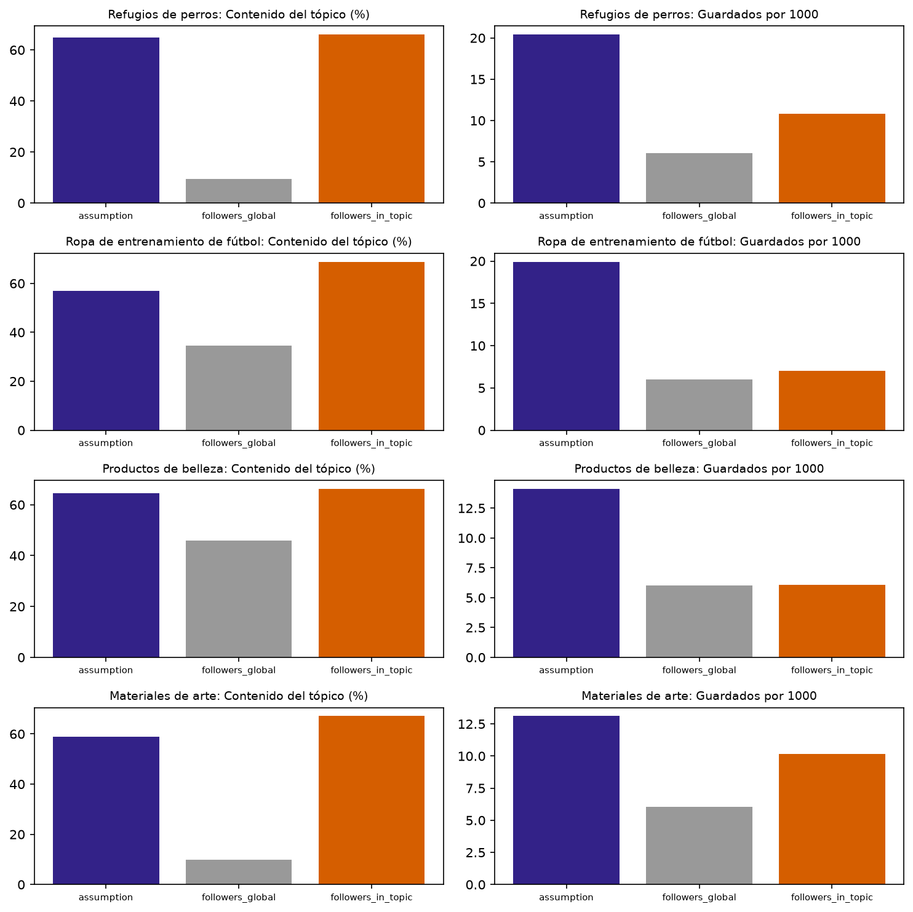

Evidencia: `runs/campaigns/{picks,baselines,comparison,strategy_profiles}.csv`. Las reglas están en `configs/campaigns.json` y las medias por celda permiten revisar las alternativas.

**Mantenimiento.** Una nueva campaña requiere definir objetivo, público y supuestos; revisar las celdas y variables pertinentes y comparar alternativas. Si sigue usando el mismo catálogo y variables, no obliga a cambiar las reglas de aprendizaje. Para un creador nuevo se puede aplicar la media/desvío existentes y asignar su ganadora y sus proyecciones, mientras no cambie la distribución; este repositorio regenera el análisis completo al actualizar el CSV. Más creadores o cambios mensuales justifican revisar distribuciones, correlaciones, escalas, entrenamientos y selección de grilla. Incorporar variables cambia las distancias, los pesos y las componentes: exige nueva selección/estandarización y repetir los modelos. Las coordenadas, signos y números de celda no son etiquetas comerciales permanentes. Deben guardarse datos, parámetros, fecha y versión de cada análisis, y volver a contrastar los supuestos con resultados comerciales cuando existan.
