# Ejercicio 2 — Memoria asociativa (Hopfield): hallazgos

Los números y gráficos de esta nota salen de corridas de `python -m tp4 run <config>` (los comandos
están al final de cada sección, en "Cómo regenerar"). Los valores citados se copian de
`runs/hopfield_letters/summary.json`, `runs/hopfield_qr/summary.json` y de los CSV de cada corrida, y
`python -m tp4.findings` verifica que cada archivo referenciado exista y que los números clave aparezcan
en el texto. Los decimales van con coma. La red de Hopfield está escrita a mano en numpy
(`tp4/models/hopfield.py`), sin ninguna librería de redes neuronales. Los gráficos son copias versionadas en `docs/hallazgos/figuras/`: el título de cada imagen nombra el artefacto de `runs/` que la produce y, por lo tanto, la config que la genera. `python -m tp4.delivery verify` regenera todo desde cero y compara números y gráficos byte a byte; `python -m tp4.delivery figures` actualiza las copias después de una regeneración.

El enunciado recomienda probar primero el caso simple antes de pasar a las imágenes, así que la sección 2.2
(letras de 5×5) va **antes** que la 2.1 (códigos QR de 37×37). Además el argumento de los QR se apoya en lo que
mostramos con las letras: la ortogonalidad de los patrones y la capacidad de la red. Los títulos conservan la
numeración del enunciado (2.1 y 2.2) para poder ubicarlos después.

## Resumen para la presentación

Esta sección es el esqueleto de las diapositivas: qué sección responde cada pregunta del enunciado, una diapositiva por hallazgo (afirmación, figura y número) y la historia que une las letras con los códigos QR. Los números de acá son los mismos valores que ya cita el texto de abajo, y `python -m tp4.delivery check` los verifica contra las corridas; si armás una diapositiva con otro número, buscalo primero en la sección que lo explica.

### Preguntas del enunciado y dónde se responden

| Pregunta del enunciado | Dónde se responde |
|------------------------|-------------------|
| **2.1** "representar cada uno mediante una matriz binaria" | `### Los cinco códigos como matrices de 37×37`, `### Por qué los cinco códigos se parecen tanto` |
| **2.1** "almacenar los cinco vectores en la red y construir patrones de consulta" | `### Red de Hopfield implementada`, `### Regla de Hebb: ningún código se recupera`, `### Regla de la pseudoinversa: la misma red sin la interferencia` |
| **2.1** "analizar la alteración de los códigos QR mediante la adición de ruido aleatorio con distintos niveles de ruido" | `### Deterioro: ruido, esquina rota y manchas` |
| **2.1** "analizar la cantidad de iteraciones y la energía en cada paso de la red" | `### Iteraciones y energía en cada paso` |
| **2.1** "explicar las limitaciones del caso de uso" | `### Limitaciones del caso de uso` |
| **2.1** "recuperar los códigos QR deteriorados y enviarlos a un lector de QR para que pueda decodificarlos" | `### Lectura con un decodificador QR` |
| **2.2** "almacenar patrones de letras. Implementar el modelo de Hopfield para asociar matrices con los patrones de las letras almacenadas" | `### Red de Hopfield implementada`, `### Ortogonalidad: qué 4 letras guardar`, `### Recuperación de letras con ruido` |
| **2.2** "realizar un análisis de ortogonalidad y de la capacidad de almacenamiento de la red" | `### Ortogonalidad: qué 4 letras guardar`, `### Capacidad de almacenamiento` |
| **2.2** "ingresar un patrón muy ruidoso e identificar un estado espúreo" | `### Un patrón muy ruidoso y un estado espúreo` |

### Guion para las diapositivas

1. **Escribimos la red de Hopfield a mano en numpy: pesos de Hebb con diagonal cero, energía y actualización asincrónica o sincrónica.** [Energía por actualización individual de neurona](figuras/hopfield_letters__energy.png). Número: la energía no sube en ninguna actualización (`energy_never_increased` = true). Es la misma red para las letras y para los códigos QR.
2. **De las letras dibujadas a mano, las más ortogonales son G, R, T y V: su producto interno máximo es 1 en valor absoluto, contra 21 en el peor conjunto.** [Alfabeto con el conjunto elegido y el peor](figuras/hopfield_letters__alphabet.png) y [productos internos entre las letras](figuras/hopfield_letters__dot_products.png). Números: `selected_max_abs_dot` = 1 y `worst_max_abs_dot` = 21. En el peor conjunto la red ya cambia píxeles de letras guardadas exactas.
3. **La cota teórica de Hebb es de 3,45 patrones y guardamos cuatro letras, por encima de la cota: funciona solo porque son casi ortogonales.** [Capacidad empírica](figuras/hopfield_letters__capacity.png). Número: `capacity_0138` = 3,45. Cuántas letras caben depende de cuán correlacionadas estén, no solo de cuántas sean.
4. **Las cuatro letras se recuperan sin errores hasta el nivel de ruido 0,12; el conjunto peor queda muy por debajo.** [Recuperación frente al nivel de ruido](figuras/hopfield_letters__recovery_vs_noise.png) y [ejemplos de recuperación](figuras/hopfield_letters__recall_examples.png). Número: `selected_max_level_full_recovery` = 0,12, con el modo asincrónico, que es el que siempre converge.
5. **Una letra muy ruidosa termina en un estado estable que no es ninguna letra guardada ni su negativo: una mezcla de letras con signo.** [Consulta ruidosa, estado espúreo y letras guardadas](figuras/hopfield_letters__spurious.png). Números: con el nivel que llamamos "muy ruidoso" (criterio nuestro), `spurious_rate` = 0,395 de las consultas termina en un estado espúreo, y las 16 mezclas de tres letras con signo son puntos fijos (`n_stable_mixtures` = 16).
6. **Los cinco códigos QR comparten la mayor parte de sus módulos: son todo menos ortogonales.** [Matriz de superposiciones entre los códigos](figuras/hopfield_qr__overlaps.png) y [módulos idénticos en los cinco códigos](figuras/hopfield_qr__shared_modules.png). Números: superposición media 0,6701 (`mean_offdiag_overlap`) y fracción de módulos compartidos 0,6976 (`shared_module_frac`). Las letras elegidas estaban en el otro extremo.
7. **Con la regla de Hebb del curso ninguno de los cinco códigos es un punto fijo y ninguna consulta se recupera: casi todas terminan en el "QR promedio".** [Estado al que llegan todas las consultas con Hebb](figuras/hopfield_qr__hebb_attractor.png). Números: `hebb_n_fixed_points` = 0 de 5 y `hebb_frac_mean_attractor` = 0,9747 de las consultas en ese mismo estado. Es la interferencia que las letras ortogonales evitaban, y no se suaviza: con la regla del curso, Hebb no recupera ningún código.
8. **Con otra regla, la pseudoinversa, que no es la del curso y está solo para comparar, los cinco códigos pasan a ser puntos fijos y se recupera todo hasta 0,35 de ruido.** [Recuperación exacta frente al tipo de deterioro](figuras/hopfield_qr__recovery_vs_noise.png). Números: `pseudoinverse_n_fixed_points` = 5 y `pseudoinverse_max_level_full_recovery` = 0,35. Sirve para probar que lo que rompe a Hebb es la correlación; no reemplaza el resultado de Hebb.
9. **La energía no sube en ningún paso y casi todas las consultas convergen en pocos barridos, pero la red baja al mínimo más cercano, que con Hebb es el equivocado.** [Iteraciones hasta converger frente al ruido](figuras/hopfield_qr__iterations.png) y [energía después de cada actualización](figuras/hopfield_qr__energy_per_step.png). Número: `energy_never_increased` = true.
10. **El lector decodifica los cinco originales y, tras la pseudoinversa, un código recuperado se lee igual de bien que se recupera; tras Hebb no lee ninguno.** [Fracción que el lector decodifica, antes y después de la red](figuras/hopfield_qr__decode_vs_noise.png). Número: `n_originals_decoded` = 5. El "QR promedio" de Hebb no se lee como ningún menú: falla de manera visible.
11. **El caso de uso queda limitado por la correlación entre códigos, los estados espúreos, la capacidad efectiva y el umbral de ruido.** [Ejemplos de consultas dañadas y su estado final](figuras/hopfield_qr__damage_examples.png). Número: la cota `capacity_0138` = 188,922 patrones está muy por encima de los cinco códigos y aun así Hebb no guarda ninguno. El umbral de ruido es el de la pseudoinversa, y una foto real no es una matriz limpia y alineada.

### Hilo conductor

La ortogonalidad es el hilo: las letras elegidas tienen un producto interno máximo de 1 en valor absoluto, son estables y se recuperan sin errores hasta el nivel de ruido 0,12, aunque con mucho ruido aparecen estados espúreos (`spurious_rate` = 0,395, y las 16 mezclas de tres letras con signo son puntos fijos). Los códigos QR, en cambio, comparten la mayor parte de sus módulos (`mean_offdiag_overlap` = 0,6701 y `shared_module_frac` = 0,6976), y esa correlación ahoga a la memoria de Hebb en interferencia: `hebb_n_fixed_points` es 0 de 5, ningún código es un punto fijo y `hebb_frac_mean_attractor` = 0,9747 de las consultas termina en el mismo "QR promedio". Al sacar la interferencia con otra regla, la pseudoinversa (que no es la del curso), la misma red recuerda los cinco códigos y recupera todo hasta 0,35 de ruido, lo que confirma que la causa es la correlación y no la cantidad de patrones (la cota `capacity_0138` de 188,922 está muy por encima de cinco). Por eso el caso de uso queda limitado por la correlación entre códigos, por los estados espúreos, por una capacidad efectiva mucho menor que la cota y por el umbral de ruido de la pseudoinversa, y con la regla del curso no se recupera ningún código.

## 2.2 Recomendación: letras 5×5

Todo lo de esta sección sale de `runs/hopfield_letters/`, regenerado con los comandos de "Cómo regenerar (2.2)".
Las decisiones de "Supuestos (2.2)" y de "Supuestos (2.1)" son criterio nuestro y el grupo las aceptó en la revisión de la Fase 4 (el alfabeto y la regla de ortogonalidad, la definición de espúreo, qué es "muy ruidoso", negro = +1, los modelos de deterioro, la pseudoinversa como comparación y zxing-cpp).

### Red de Hopfield implementada

**Escribimos la red de Hopfield a mano en numpy: pesos de Hebb con diagonal cero, actualización asincrónica o sincrónica, energía y tres criterios de corte.**

- Los patrones son vectores `ξ` de N neuronas con valores en {−1, +1}; para letras de 5×5, **N = 25** (`n_neurons` en
  `runs/hopfield_letters/summary.json`).
- **Pesos de Hebb:** `w_ij = (1/N)·Σ_μ ξ_i^μ ξ_j^μ` para `i ≠ j` y `w_ii = 0` (la matriz es simétrica).
- **Campo local y regla de actualización:** `h_i = Σ_j w_ij S_j` y `S_i = signo(h_i)`; si `h_i = 0` la neurona **conserva su estado**
  (así la regla no inventa un signo cuando no hay información).
- **Dos formas de actualizar:** *asincrónica* (se visitan las N neuronas en un orden aleatorio por barrido, una por vez, con la semilla de la config)
  y *sincrónica* (`S(t+1) = signo(W·S(t))`, todas juntas).
- **Energía:** `H(S) = −½·Σ_ij w_ij S_i S_j`.
- **Criterios de corte:** (1) un barrido sin ningún cambio (convergió), (2) en modo sincrónico, un ciclo de período 2 (`S(t+1) = S(t−1)`),
  (3) `max_iter` barridos (100 en esta corrida).
- **Qué garantiza pytest** (`tests/test_hopfield_model.py`, 16 tests): las letras G, R, T y V guardadas y patrones aleatorios guardados son puntos fijos (con las dos reglas de actualización),
  la energía **no sube** en ninguna actualización individual en modo asincrónico, el ejemplo resuelto del curso da el resultado de las diapositivas,
  una consulta resulta igual sola o dentro de un lote, y ningún módulo de `tp4/` importa una librería de redes.
- **Por qué asincrónico es el modo por defecto:** converge siempre (la energía baja en cada cambio y está acotada), mientras que el sincrónico puede
  oscilar entre dos estados. En las corridas de ruido de abajo, el asincrónico tuvo `n_async_cycles` = 0 ciclos y el sincrónico
  `n_sync_cycles` = 144 (de las 1600 consultas de cada modo sobre G, R, T y V; el conjunto peor no cicla nunca).

### Ortogonalidad: qué 4 letras guardar

**De 26 letras dibujadas a mano, las 4 más ortogonales son G, R, T y V: el producto interno más grande entre dos de ellas es 1, contra 21 en el peor conjunto.**

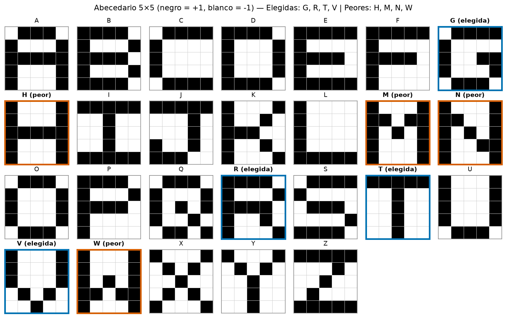

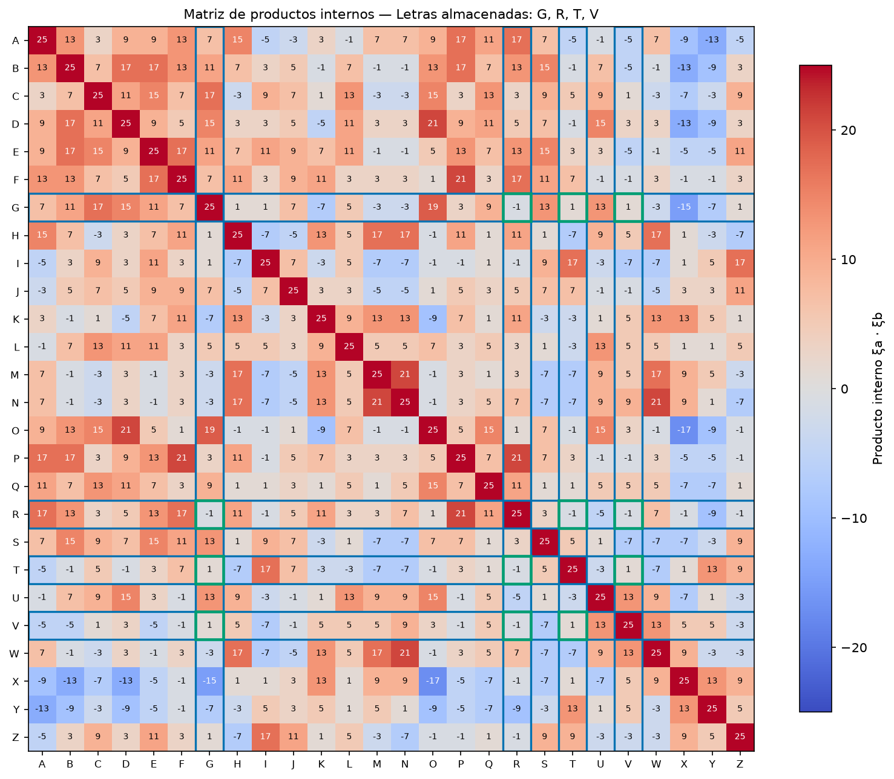

- La regla (`selection_rule` en `runs/hopfield_letters/summary.json`, y se fijó antes de mirar los resultados): *menor máximo |producto interno|
  fuera de la diagonal, luego menor promedio |producto interno|, luego orden alfabético.* Se evalúan los **14950** subconjuntos de 4 letras
  (`n_subsets` = 14950, es decir C(26, 4)) con la matriz de `runs/hopfield_letters/dot_products.csv`; el ranking completo está en `runs/hopfield_letters/orthogonality.csv`.
- Dos patrones de 25 píxeles tienen producto interno 25 consigo mismos y un valor impar entre −25 y 25 con otro; el valor mínimo posible de |producto interno|
  entre dos letras distintas es 1, y el conjunto elegido lo alcanza en los seis pares.

**Letras almacenadas:** G, R, T y V, con `selected_max_abs_dot` = 1 y `selected_mean_abs_dot` = 1,0 (los seis pares valen ±1).

- **Contraste con el peor conjunto** (`worst_letters` = H, M, N, W): `worst_max_abs_dot` = 21 y promedio 18,3333. Las cuatro tienen los dos palos
  verticales de los costados en común (columnas 1 y 5 completas o casi), así que sus patrones se parecen mucho entre sí.
- **Por qué importa la ortogonalidad:** al evaluar `h_i` sobre un patrón guardado `ξ^ν`, el término de interés vale `ξ_i^ν` pero aparece además un
  término de interferencia (*crosstalk*, diapositiva 33 del curso) que suma los productos internos con los demás patrones. Con productos internos
  chicos esa interferencia no alcanza para cambiar un signo; con productos grandes sí.
- **Margen de estabilidad** (`min_i ξ_i·h_i`, positivo si todos los píxeles son estables; `runs/hopfield_letters/stored.csv`):

| Conjunto | Letras | Márgenes | Puntos fijos |
|----------|--------|----------|--------------|
| Elegido | G, R, T, V | 0,72; 0,72; 0,72; 0,72 (`selected_stability_margins`) | `selected_n_fixed_points` = 4 de 4 |
| Peor | H, M, N, W | −1,2; −1,36; 0,16; −1,36 | `worst_n_fixed_points` = 1 de 4 (solo N) |

- Con el peor conjunto, tres de las cuatro letras guardadas **ni siquiera son estables**: la red ya cambia píxeles de una H, una M o una W exactas.

### Capacidad de almacenamiento

**Con N = 25 la cota teórica de la red de Hebb es de 3,45 a 3,75 patrones; guardamos 4, por encima de las dos cotas, y funciona solo porque estas 4 letras son casi ortogonales.**

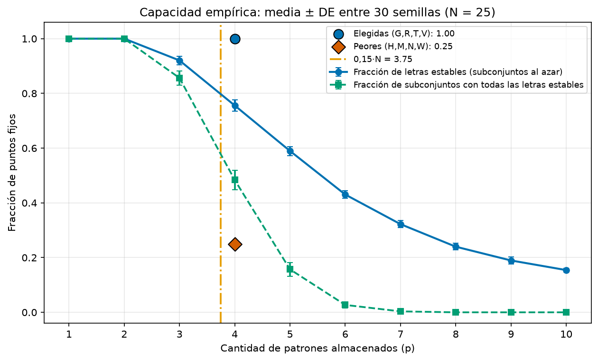

- Cotas del curso: `capacity_0138` = 3,45 (0,138·N) y `capacity_015` = 3,75 (0,15·N). `n_store` = 4 queda por encima de las dos.
- Curva empírica (`runs/hopfield_letters/capacity.csv`): para cada p se toman 200 subconjuntos aleatorios de p letras de nuestro alfabeto y
  se cuenta qué fracción de las letras guardadas son puntos fijos y qué fracción de los conjuntos las tiene **todas** estables.

| p letras guardadas | Fracción de letras estables | Fracción de conjuntos con todas estables |
|--------------------|-----------------------------|-------------------------------------------|
| 1 | 1,0 | 1,0 |
| 2 | 1,0 | 1,0 |
| 3 | 0,9483 | 0,91 |
| 4 | 0,7525 | 0,465 |
| 5 | 0,572 | 0,14 |
| 6 | 0,4275 | 0,03 |
| 7 | 0,3064 | 0,0 |
| 8 | 0,2669 | 0,0 |
| 9 | 0,1967 | 0,0 |
| 10 | 0,1485 | 0,0 |
| 4 (elegidas G, R, T, V) | 1,0 | 1,0 |
| 4 (peores H, M, N, W) | 0,25 | 0,0 |

- Con 4 letras **al azar**, en el 46,5% de los conjuntos todas las letras son estables; con las 4 elegidas por ortogonalidad, siempre. Con las peores, solo una de cuatro.
- **Conclusión:** la capacidad que importa depende de cuán correlacionados estén los patrones, no solo de cuántos sean. Con nuestro alfabeto la memoria
  sostiene 4 letras únicamente porque las elegimos casi ortogonales. Esta curva depende de nuestro alfabeto (ver Supuestos).

### Recuperación de letras con ruido

**Las 4 letras se recuperan sin errores hasta 3 píxeles invertidos de 25 (nivel 0,12) y la recuperación cae a menos de la mitad desde 9 píxeles; el conjunto peor nunca pasa de 0,25.**

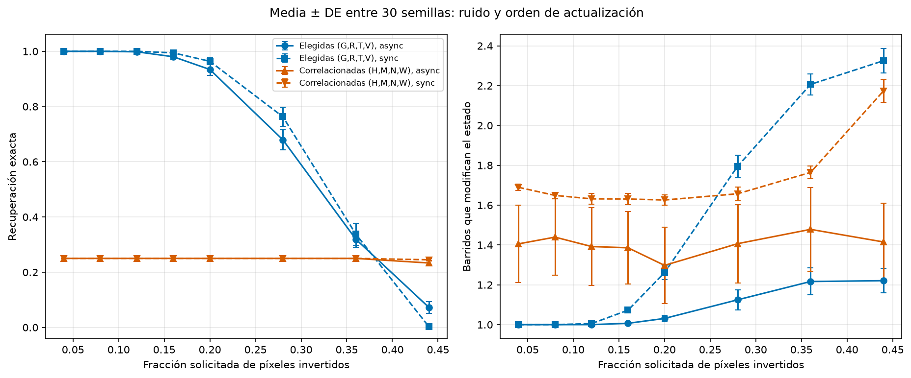

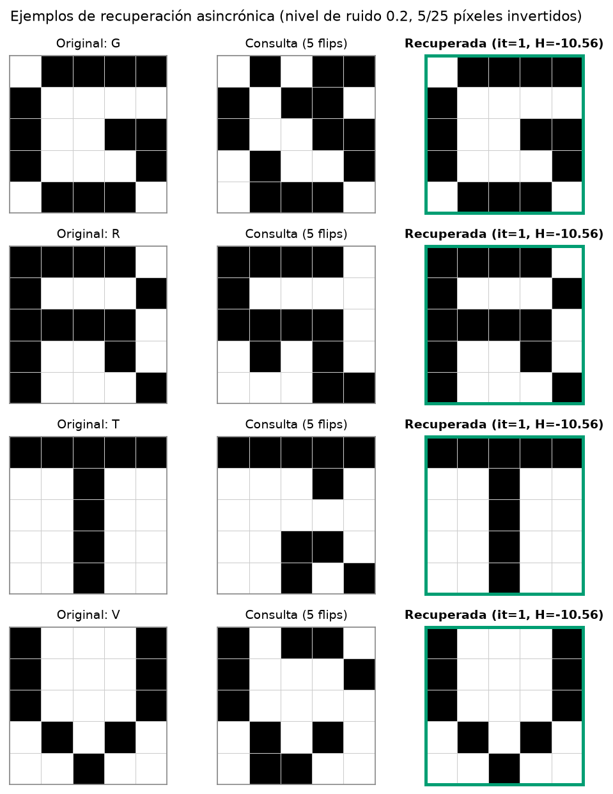

Conjunto G, R, T, V, 50 consultas por letra y nivel (200 por celda), cada una con ese número de píxeles invertidos al azar
(`runs/hopfield_letters/recall_rates.csv`; "recuperada" = el estado final es exactamente la letra de origen):

| Nivel | Píxeles | Async: recuperada | Async: espúrea | Async: invertida | Sync: recuperada | Sync: espúrea | Sync: ciclos |
|-------|---------|-------------------|----------------|------------------|------------------|---------------|--------------|
| 0,04 | 1 | 1,0 | 0,0 | 0,0 | 1,0 | 0,0 | 0,0 |
| 0,08 | 2 | 1,0 | 0,0 | 0,0 | 1,0 | 0,0 | 0,0 |
| 0,12 | 3 | 1,0 | 0,0 | 0,0 | 1,0 | 0,0 | 0,0 |
| 0,16 | 4 | 0,98 | 0,02 | 0,0 | 1,0 | 0,0 | 0,0 |
| 0,2 | 5 | 0,915 | 0,085 | 0,0 | 0,95 | 0,05 | 0,015 |
| 0,28 | 7 | 0,645 | 0,315 | 0,02 | 0,77 | 0,225 | 0,12 |
| 0,36 | 9 | 0,255 | 0,48 | 0,16 | 0,315 | 0,545 | 0,305 |
| 0,44 | 11 | 0,045 | 0,34 | 0,355 | 0,0 | 0,455 | 0,28 |

- `selected_max_level_full_recovery` = 0,12: hasta ese nivel el modo asincrónico recupera el 100% de las consultas.
- **1 y 2 píxeles invertidos se recuperan siempre.** No solo en estas 200 consultas por celda: un test exhaustivo
  (`tests/test_hopfield_letters.py`) prueba **todas** las consultas de 1 y 2 píxeles invertidos de G, R, T y V con 5 semillas del orden asincrónico y todas
  vuelven a su letra.
- A partir de 0,28 aparecen también consultas que terminan en **otra letra guardada** (0,02 a nivel 0,28; 0,105 a 0,36; 0,26 a 0,44) y en la **letra invertida**
  (estado `−ξ`, que también es un punto fijo de la red, porque la energía no cambia si se invierten todos los signos): con 11 píxeles invertidos de 25 el 35,5% de las consultas
  ya termina en el negativo de alguna letra.
- **Conjunto peor** (H, M, N, W; `worst_async_recovery`): queda clavado en 0,25 en todos los niveles hasta 0,36 y baja a 0,24 en 0,44. Es el 25% de las consultas que
  parten de N, la única letra estable: todas las consultas de H, M y W (0,75 es "otra letra") terminan en N (o en su negativo), porque sus propios patrones ni siquiera son puntos fijos.
  Esto se ve en `runs/hopfield_letters/recall.csv` (columna `final_letter`).
- **Asincrónico contra sincrónico:** el sincrónico recupera algo más en los niveles medios (0,77 contra 0,645 en 0,28), pero se queda sin recuperar nada en 0,44 y
  entra en ciclos de período 2 en hasta el 30,5% de las consultas (`n_sync_cycles` = 144 en total); el asincrónico nunca cicla. Elegimos el asincrónico como modo principal
  porque tiene garantía de convergencia aunque una tasa de recuperación algo menor en ruido medio.

### Un patrón muy ruidoso y un estado espúreo

**Una G con 10 de 25 píxeles invertidos termina en un estado estable que no es ninguna letra guardada ni su negativo: una mezcla de tres letras.**

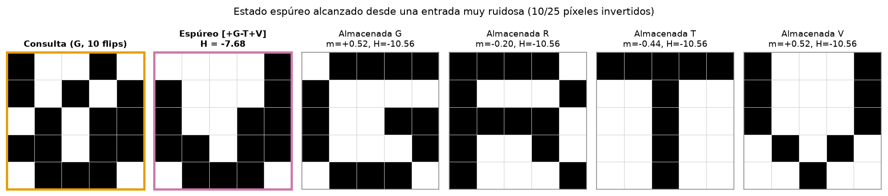

**Estado espúreo:** partiendo de una G con `spurious_n_flips` = 10 píxeles invertidos (nivel 0,4, "muy ruidoso"), la red converge a un estado cuya letra guardada más cercana es la G (`spurious_nearest_letter` = G; la V empata con la misma superposición y el desempate elige la primera) pero a distancia de Hamming `spurious_hamming_to_nearest` = 6 de ella, con superposiciones con (G, R, T, V) de 0,52; -0,2; -0,44 y 0,52 (`spurious_overlaps`) y energía `spurious_energy` = -7,68, **más alta** que la de cada letra guardada (-10,56 en las cuatro, `stored_energies`).

- **Es espúreo y no invertido:** no coincide con ninguna de las 4 letras ni con ninguna de sus negativas (se clasifica por igualdad exacta de los 25 píxeles), y es un **punto fijo**:
  la corrida lo confirma porque ninguna neurona cambia en el último barrido. Es un mínimo local de energía más alto que el de las letras.
- **Es una mezcla:** el estado es el signo de `+G −T +V` (`spurious_mixture`), una combinación de tres letras guardadas con signos (un estado de mezcla), que es el tipo de espúreo esperable
  cuando los patrones no son del todo ortogonales. De hecho **las 16 mezclas de tres letras con signo son puntos fijos** (`n_stable_mixtures` = 16 de 16, `runs/hopfield_letters/mixtures.csv`).
- **Con qué frecuencia pasa:** con 10 píxeles invertidos, el 39,5% de las consultas del conjunto elegido (200 consultas, asincrónico) terminan en un estado espúreo
  (`spurious_rate` = 0,395) y otro 24% en una letra invertida (`inverted_rate_at_spurious_noise` = 0,24). Es el ejemplo de la primera consulta espúrea que converge, en el orden
  (letra, intento) con la semilla fija: otra semilla mostraría otro igual de válido.
- **Energía:** el estado espúreo y las letras tienen energías distintas, y la curva de energía por actualización individual no sube nunca
  (`energy_never_increased` = true):

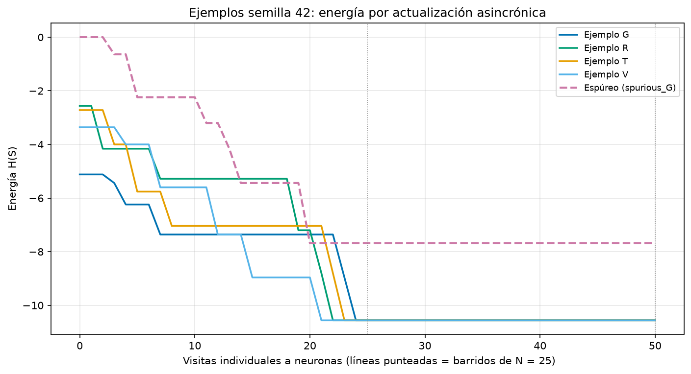

### Supuestos (2.2)

- **El alfabeto es nuestro:** las 26 letras de 5×5 están dibujadas a mano en `datos/letras_5x5.json` (la J se copió del enunciado), no las dio el curso. Los productos internos, el
  conjunto elegido y la curva de capacidad dependen de esos dibujos.
- **Regla de ortogonalidad:** "más ortogonal" significa menor máximo |producto interno| entre pares, luego menor promedio, luego orden alfabético. Es criterio nuestro y se fijó antes de ver los resultados.
- **Definición de espúreo:** un punto fijo que no es ninguna letra guardada **ni** su negativa; las letras invertidas se cuentan aparte. El ejemplo mostrado es la primera consulta espúrea que termina convergida.
- **"Muy ruidoso" = 10 de 25 píxeles (nivel 0,4):** es una elección nuestra (el enunciado no fija un número); con ese nivel el 39,5% de las consultas termina en un estado espúreo.
- **Orden asincrónico:** una permutación aleatoria de las 25 neuronas por barrido, compartida por todas las consultas de un lote, con semilla fija; los resultados no dependen de cómo se agrupen las consultas.
- **Iteraciones:** se cuentan solo los barridos que cambiaron el estado; el último barrido sin cambios es el chequeo de convergencia y no suma.
- **Capacidad empírica:** 200 subconjuntos aleatorios por p (hasta p = 10) y la misma semilla; depende del alfabeto.
- **Solo numpy:** ni la red ni el análisis usan librerías de redes neuronales; la regla de Hebb es la del curso.
- Los gráficos son copias versionadas en `docs/hallazgos/figuras/`; el título de cada imagen nombra la corrida de `runs/` que la produce. `python -m tp4.delivery verify` las compara byte a byte con una regeneración limpia y `python -m tp4.delivery figures` actualiza las copias.

### Cómo regenerar (2.2)

```bash
.venv/bin/python -m tp4 run configs/hopfield_letters.json
```

Verificación de la evidencia (los 21 valores de 2.2):

```bash
.venv/bin/python -m tp4.findings docs/hallazgos/ej2.md \
  --cite runs/hopfield_letters/summary.json:selected_letters \
  --cite runs/hopfield_letters/summary.json:selected_max_abs_dot \
  --cite runs/hopfield_letters/summary.json:selected_mean_abs_dot \
  --cite runs/hopfield_letters/summary.json:worst_letters \
  --cite runs/hopfield_letters/summary.json:worst_max_abs_dot \
  --cite runs/hopfield_letters/summary.json:n_subsets \
  --cite runs/hopfield_letters/summary.json:capacity_0138 \
  --cite runs/hopfield_letters/summary.json:capacity_015 \
  --cite runs/hopfield_letters/summary.json:selected_n_fixed_points \
  --cite runs/hopfield_letters/summary.json:worst_n_fixed_points \
  --cite runs/hopfield_letters/summary.json:selected_stability_margins \
  --cite runs/hopfield_letters/summary.json:selected_max_level_full_recovery \
  --cite runs/hopfield_letters/summary.json:n_sync_cycles \
  --cite runs/hopfield_letters/summary.json:spurious_n_flips \
  --cite runs/hopfield_letters/summary.json:spurious_rate \
  --cite runs/hopfield_letters/summary.json:spurious_letter \
  --cite runs/hopfield_letters/summary.json:spurious_nearest_letter \
  --cite runs/hopfield_letters/summary.json:spurious_hamming_to_nearest \
  --cite runs/hopfield_letters/summary.json:spurious_overlaps \
  --cite runs/hopfield_letters/summary.json:spurious_energy \
  --cite runs/hopfield_letters/summary.json:n_stable_mixtures
```

## 2.1 Recuperación de códigos QR deteriorados

Todo lo de esta sección sale de `runs/hopfield_qr/`, regenerado con los comandos de "Cómo regenerar (2.1)". La historia del enunciado es un código de un menú
de restaurante "desgastado, rayado, manchado con comida o rasgado" que hay que recuperar y mandar "a un lector de QR para que pueda decodificarlo". Probamos
**dos reglas de aprendizaje** sobre la misma red: la de Hebb, que es la del curso, y la de la pseudoinversa, que **no es la del curso** y está solo para comparar.
Los resultados de Hebb van primero y no se esconden detrás de los de la pseudoinversa. Las decisiones que son criterio nuestro están en "Supuestos (2.1)".

### Los cinco códigos como matrices de 37×37

**Cada menú es un QR de versión 5 de 37×37 módulos, es decir, un vector de N = 1369 neuronas con negro = +1 y blanco = −1, sin zona de silencio.**

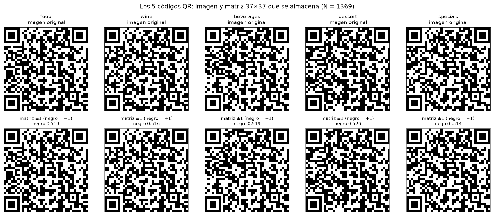

- `n_neurons` = 1369 (37 × 37). La fracción de módulos negros de cada código va de 0,5142 a 0,5259 (`black_fractions` en `runs/hopfield_qr/summary.json`).
- Control: cada matriz se vuelve a dibujar como imagen y es **idéntica píxel por píxel** al PNG original (`roundtrip_identical` = true), y el lector de QR decodifica los 5 originales.
- Los cinco archivos son `datos/hopfield/{food,wine,beverages,dessert,specials}_menu_qr.png`.

### Por qué los cinco códigos se parecen tanto

**Los cinco códigos comparten 955 de 1369 módulos (0,6976) y su superposición media es de 0,6701: son todo menos ortogonales.**

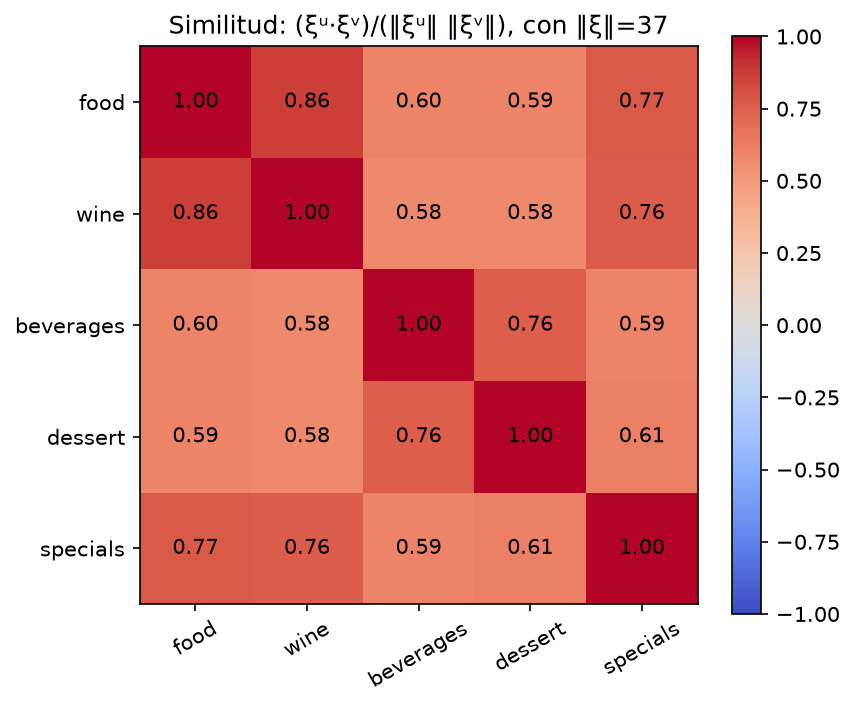

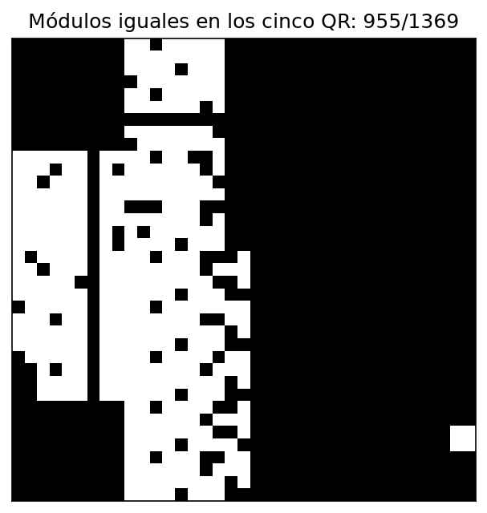

- Superposición `m = (1/N)·ξ·ξ'` entre pares distintos (`runs/hopfield_qr/overlaps.csv`): media `mean_offdiag_overlap` = 0,6701 y máxima `max_offdiag_overlap` = 0,8598, entre `max_overlap_pair` = food-wine.
  Con m = 0,6701 dos códigos coinciden en alrededor del 83,5% de los módulos (la fracción de acuerdo es (1 + m) / 2). Para comparar: las letras elegidas en 2.2 tenían un producto interno de ±1 sobre 25, es decir una superposición de ±0,04.
- Módulos idénticos en los cinco códigos: `n_shared_modules` = 955, `shared_module_frac` = 0,6976; los otros 414 difieren en al menos un código y están concentrados en una franja a la izquierda de la zona de datos (figura de arriba).
- **Por qué:** todos son QR de la misma versión, así que comparten los tres patrones de posición, los patrones de alineación y sincronismo y los módulos de formato; además las cinco URL son iguales salvo el nombre del menú
  (`.../TPs/TP4/food_menu.png`, `wine_menu.png`, ...), de modo que buena parte de los datos también coincide.

### Regla de Hebb: ningún código se recupera

**Con la regla de Hebb del curso, ninguno de los cinco códigos es un punto fijo y ninguna consulta se recupera: todas terminan en el mismo "QR promedio".**

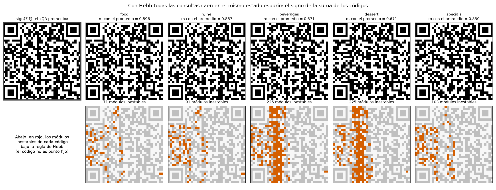

- **Puntos fijos:** `hebb_n_fixed_points` = 0 de 5. La cantidad de módulos inestables (módulos que la red cambiaría estando en el código exacto, `hebb_unstable_bits`) es 71, 91, 225, 225 y 103 para food, wine, beverages, dessert y specials
  (`runs/hopfield_qr/stored.csv`), con márgenes de estabilidad negativos de −1,5310 a −1,8232. En la figura, los módulos inestables caen en la zona de datos y no sobre los patrones de posición.
- **Recuperación:** 0,0 en los 11 niveles de ruido, en los 7 tamaños de esquina rota y en los 5 tamaños de mancha (`runs/hopfield_qr/recovery_rates.csv`). Incluso con ruido 0,0, o sea con el código exacto como entrada, la red lo abandona.
- **A dónde llegan:** al estado `signo(Σ ξ)`, que llamamos "QR promedio" (la figura de arriba, a la izquierda). `hebb_frac_mean_attractor` = 0,9747: el 97,47% de todas las consultas de Hebb terminan exactamente en ese estado,
  y el resto en otros estados espúreos. Su superposición con cada código es `hebb_mean_attractor_overlaps` = 0,8963; 0,8671; 0,6713; 0,6713 y 0,8495 (food, wine, beverages, dessert, specials): se parece a todos y no es ninguno.
- **El "QR promedio" es un mínimo de energía más profundo que los propios códigos:** su energía es -2172,88, contra -2077,4492 (food) a -1789,7064 (beverages) de los códigos guardados (`runs/hopfield_qr/stored.csv`). La red está haciendo bien su trabajo
  (bajar la energía) y por eso se aleja de los códigos.
- **Conexión con 2.2:** esta es la interferencia (*crosstalk*) que las letras casi ortogonales evitaban. Y no es un problema de cantidad de patrones: la cota `capacity_0138` = 188,922 patrones (0,138·N) está muy por encima de los 5 códigos, y aun así
  no entra ninguno. Con patrones tan correlacionados la capacidad efectiva de Hebb es menor que 5, no 189.

### Regla de la pseudoinversa: la misma red sin la interferencia

**Con una regla de aprendizaje distinta (la pseudoinversa, que no es la del curso) los cinco códigos pasan a ser puntos fijos, y eso confirma que lo que rompe a Hebb es la correlación.**

- **Regla:** `W = K·(KᵀK)⁻¹·Kᵀ` con la diagonal en cero, donde `K` tiene los cinco códigos como columnas. Es la proyección sobre el espacio que generan los códigos. Es **otra regla de aprendizaje** que la de Hebb; la red es la misma:
  mismas neuronas, mismas actualizaciones asincrónicas, misma energía. Necesita que los códigos sean linealmente independientes (lo son).
- **Resultado:** `pseudoinverse_n_fixed_points` = 5 de 5 (0 módulos inestables en cada uno, margen de estabilidad 0,9808 y energía -682 para los cinco).
- **Para qué está acá:** para probar la explicación. Si la causa del fracaso de Hebb es la correlación entre códigos, al sacar la interferencia la misma red tiene que recordarlos, y lo hace.
  No se presenta como la red de Hopfield del curso ni sus números reemplazan a los de Hebb de arriba.

### Deterioro: ruido, esquina rota y manchas

**La pseudoinversa recupera el 100% de las consultas hasta invertir el 35% de los módulos, y todas las esquinas rotas y manchas hasta tamaños grandes; Hebb no recupera ninguna.**

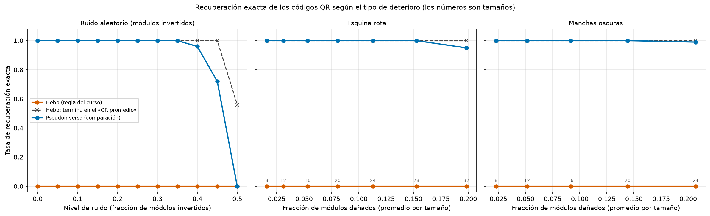

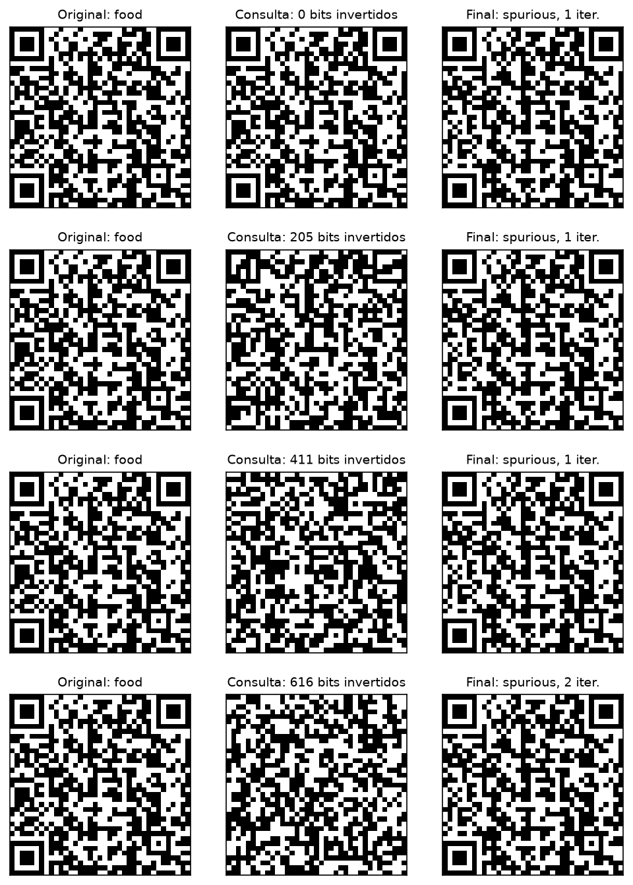

Ruido aleatorio (módulos invertidos al azar), 100 consultas por nivel y regla (20 por código); "recuperada" = el estado final es exactamente el código de origen (`runs/hopfield_qr/recovery_rates.csv`):

| Nivel | Módulos invertidos | Hebb: recuperada | Pseudoinversa: recuperada |
|-------|--------------------|------------------|----------------------------|
| 0,0 | 0 | 0,0 | 1,0 |
| 0,05 | 68 | 0,0 | 1,0 |
| 0,1 | 137 | 0,0 | 1,0 |
| 0,15 | 205 | 0,0 | 1,0 |
| 0,2 | 274 | 0,0 | 1,0 |
| 0,25 | 342 | 0,0 | 1,0 |
| 0,3 | 411 | 0,0 | 1,0 |
| 0,35 | 479 | 0,0 | 1,0 |
| 0,4 | 548 | 0,0 | 0,96 |
| 0,45 | 616 | 0,0 | 0,72 |
| 0,5 | 684 | 0,0 | 0,0 |

**Umbral de ruido:** la pseudoinversa recupera todo hasta el nivel `pseudoinverse_max_level_full_recovery` = 0,35 (479 de 1369 módulos invertidos, 35%); en 0,4 cae a 0,96, en 0,45 a 0,72 y en 0,5 a 0,0, porque invertir la mitad de los módulos no deja información sobre el código: con una fracción invertida de 0,4996 la consulta tiene una superposición casi nula con el original.

- En 0,4 y 0,45 los fracasos son otro código guardado (0,02 y 0,14) o un estado espúreo (0,02 y 0,14); en 0,5 el 36% termina en otro código guardado, el 36% en un código invertido y el 28% en un estado espúreo (`recovery_rates.csv`).

Esquina rota (un triángulo blanco en una de las cuatro esquinas; 20 consultas por tamaño: 5 códigos × 4 esquinas) y mancha (un bloque negro cuadrado en una posición al azar; 100 consultas por tamaño). La fracción de módulos que cambian es el promedio por tamaño:

| Deterioro | Tamaño | Módulos dañados (fracción) | Hebb | Pseudoinversa |
|-----------|--------|----------------------------|------|----------------|
| Esquina rota | 8 | 0,0161 | 0,0 | 1,0 |
| Esquina rota | 12 | 0,0311 | 0,0 | 1,0 |
| Esquina rota | 16 | 0,0533 | 0,0 | 1,0 |
| Esquina rota | 20 | 0,0808 | 0,0 | 1,0 |
| Esquina rota | 24 | 0,113 | 0,0 | 1,0 |
| Esquina rota | 28 | 0,1527 | 0,0 | 1,0 |
| Esquina rota | 32 | 0,1984 | 0,0 | 0,95 |
| Mancha | 8 | 0,0229 | 0,0 | 1,0 |
| Mancha | 12 | 0,0515 | 0,0 | 1,0 |
| Mancha | 16 | 0,0916 | 0,0 | 1,0 |
| Mancha | 20 | 0,1442 | 0,0 | 1,0 |
| Mancha | 24 | 0,207 | 0,0 | 0,99 |

- `pseudoinverse_corner_recovery` va de 1,0 a 0,95 y `pseudoinverse_occlusion_recovery` de 1,0 a 0,99: con la esquina de tamaño 32 (casi 20% de los módulos) se pierde un código de las 20 consultas (food con la esquina inferior izquierda rota termina en wine), y con una mancha de 24
  (más del 20%) se pierde una de 100 (wine termina en food). Son estados estables de otro código, no espúreos.
- Las manchas y las esquinas son mucho más fáciles que el ruido aleatorio con la misma fracción de módulos: el daño está concentrado en una zona y el resto del código sigue intacto, mientras que el ruido distribuido toca todo el código.

### Iteraciones y energía en cada paso

**Con la pseudoinversa casi todas las consultas convergen en un barrido (1,0471 en promedio); con Hebb en 1,2828, pero hacia el estado equivocado; y la energía no sube en ningún paso.**

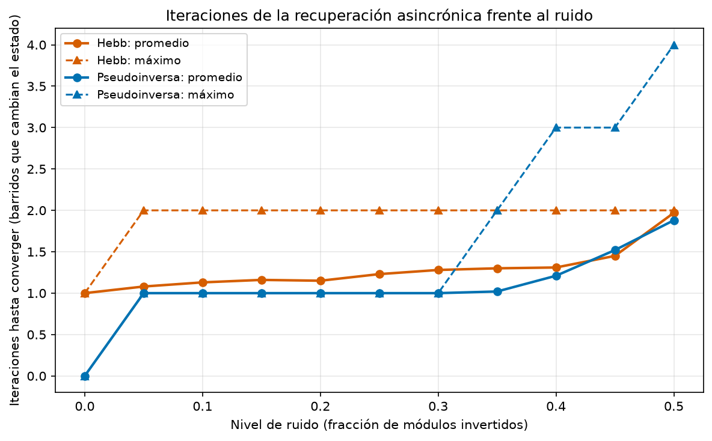

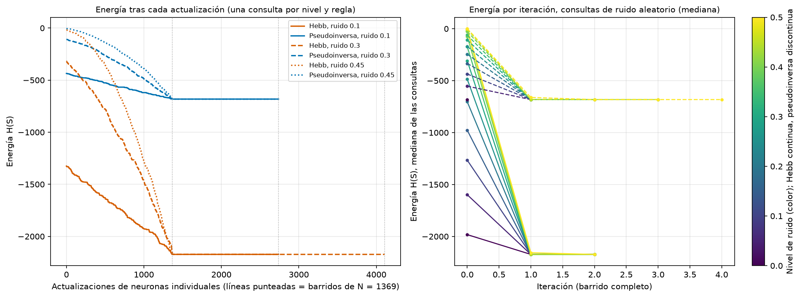

- **Iteraciones** (barridos que cambian el estado): `hebb_mean_iterations` = 1,2828 y `pseudoinverse_mean_iterations` = 1,0471; el máximo de las dos reglas es `max_iterations` = 4 (pseudoinversa, nivel 0,5, la zona sin información). Con ruido 0,0 la pseudoinversa no necesita ninguna iteración (el código ya es un punto fijo)
  y Hebb necesita una, porque sale del código. Hebb nunca pasa de 2 barridos; la pseudoinversa sube a 2 desde el nivel 0,35, a 3 desde 0,4 y a 4 en 0,5.
- **Energía:** `energy_never_increased` = true. Se verificó por iteración en todas las consultas y por cada actualización de neurona en los casos de `runs/hopfield_qr/energy_trace.csv` (el código food, intento 0, con ruido 0,1, 0,3 y 0,45, para cada regla).
- **Cómo se lee la curva por actualización** (panel izquierdo): casi toda la caída ocurre en el **primer barrido** de las 1369 neuronas (más del 99,9% de la caída total en todos los casos medidos) y el segundo barrido confirma, sin cambios (con Hebb y ruido 0,3 hay además un tercero de confirmación).
  Las curvas terminan en un valor distinto por regla: la pseudoinversa en -682, que es la energía de cada código guardado, y Hebb en -2172,88, la del "QR promedio". Partiendo de una consulta con ruido 0,1 la energía inicial es -435,8 (pseudoinversa) y -1324,86 (Hebb), y con ruido 0,45 es -4,83 y -19,08.
  A mayor ruido, más alta la energía inicial y más larga la bajada.

### Lectura con un decodificador QR

**Después de recuperar un código hay que leerlo: el lector decodifica los 5 originales y, tras la pseudoinversa, un código recuperado se lee igual de bien que se recupera; tras Hebb no lee ninguno.**

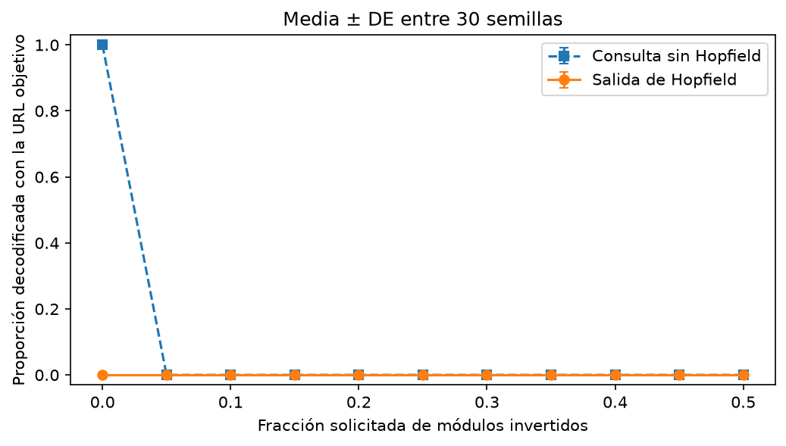

- **Decodificador:** zxing-cpp 3.1.1 (`decoder_name`, `decoder_version`; opcional, ver "Cómo regenerar (2.1)"), con cada matriz dibujada a escala 8 y zona de silencio de 4 módulos. `n_originals_decoded` = 5, y cada uno se lee como su URL (`reference_texts`):

| Código | Texto decodificado |
|--------|--------------------|
| food | https://github.com/eugepineiro/sia-tips/blob/feature/tp4-images/TPs/TP4/food_menu.png |
| wine | https://github.com/eugepineiro/sia-tips/blob/feature/tp4-images/TPs/TP4/wine_menu.png |
| beverages | https://github.com/eugepineiro/sia-tips/blob/feature/tp4-images/TPs/TP4/beverages_menu.png |
| dessert | https://github.com/eugepineiro/sia-tips/blob/feature/tp4-images/TPs/TP4/dessert_menu.png |
| specials | https://github.com/eugepineiro/sia-tips/blob/feature/tp4-images/TPs/TP4/specials_menu.png |

- **Sin la red** (solo la corrección de errores propia del QR, `query_flip_decode_rates`): con ruido 0,0 el lector decodifica 1,0 y con **cualquier** nivel desde 0,05 (68 módulos invertidos) decodifica 0,0 de las consultas. La esquina rota se lee en 0,25 de los casos con tamaños 8 y 12 (solo si le tocó la esquina inferior derecha, que no tiene patrón de posición)
  y 0,0 desde 16; la mancha de 8 se lee en 0,7 y 0,0 desde 12 (`runs/hopfield_qr/summary.json`, `query_corner_decode_rates`, `query_occlusion_decode_rates`).
- **Con la red:** la tasa de decodificación después de la pseudoinversa, `pseudoinverse_final_flip_decode_rates`, es 1,0 hasta 0,35, 0,96 en 0,4, 0,72 en 0,45 y 0,0 en 0,5; después de Hebb, `hebb_final_flip_decode_rates`, es 0,0 en todos los niveles.
  En este run las tasas de decodificación y de recuperación exacta coinciden, pero son medidas distintas: la recuperación compara los 1369 módulos y la decodificación compara el texto leído con el del código de origen (un código recuperado en otro menú se lee, pero como otro texto).
- **El "QR promedio" de Hebb no se lee como ningún menú** (`mean_attractor_decoded_as` = "none"): Hebb falla de manera visible, no devuelve un menú equivocado con seguridad.

**Decodificación:** el lector decodifica los 5 originales (`n_originals_decoded` = 5); tras la pseudoinversa decodifica el 100% de los códigos recuperados hasta 35% de ruido y tras Hebb el 0%, mientras que sin la red ya no decodifica nada con un 5% de módulos invertidos.

### Limitaciones del caso de uso

**(a) Los códigos están muy correlacionados, y eso rompe la memoria de Hebb.** `shared_module_frac` = 0,6976 y `max_offdiag_overlap` = 0,8598: la interferencia entre códigos es más grande que la señal de cada uno (0 de 5 puntos fijos, 71 a 225 módulos inestables).
Una memoria asociativa de este tipo necesita patrones casi ortogonales (2.2); los QR de un mismo menú no lo son por construcción.

**(b) Aparecen estados espúreos, y con Hebb todos son el mismo.** Con la regla del curso el 97,47% de las consultas termina en el "QR promedio" (`hebb_frac_mean_attractor` = 0,9747), que no se lee como ningún menú.
Con la pseudoinversa el ruido de 0,5 lleva a códigos invertidos (36%) y espúreos (28%), y en 2.2 vimos que las 16 mezclas de tres letras son puntos fijos espúreos y que en un 39,5% de las consultas muy ruidosas la red cae en uno.

**(c) La capacidad real es menor que la cuenta.** Por cantidad, 0,138·N = 188,922 patrones (`capacity_0138`) sobre 5 códigos parece holgado, pero con códigos así de parecidos la capacidad efectiva de Hebb queda por debajo de 5: no entra ninguno.
La curva de 2.2 lo anticipaba: con patrones sin elegir por ortogonalidad, ya con 5 letras al azar solo el 14% de los conjuntos tiene todas las letras estables.

**(d) El umbral de ruido es 0,35, y es de la pseudoinversa.** Se recupera todo hasta 479 de 1369 módulos invertidos (`pseudoinverse_max_level_full_recovery` = 0,35) y desde 0,4 empiezan los errores (0,96, 0,72 y 0,0 en 0,5, donde el 36% termina en otro menú y otro 36% en un código invertido).
Para comparar, el lector de QR solo, sin la red, ya falla con el 5% de módulos invertidos al azar (68 módulos): la red le agrega mucho margen a ese tipo de deterioro. Una explicación consistente con esto, que no medimos por separado, es que la corrección de errores del QR trabaja por palabras de código de 8 módulos
y 68 módulos invertidos al azar caen en muchas palabras distintas. En cambio, con una mancha de 8×8 el lector solo funciona en 0,7 de los casos.

**(e) La memoria solo conoce los 5 menús guardados.** Un menú nuevo obliga a reentrenar la red, y un código que no guardó se lo asigna al más parecido: con ruido 0,5 el 36% de las consultas termina en otro de los cinco códigos, y una esquina de tamaño 32 o una mancha de 24 puede terminar en otro menú
(1 de 20 y 1 de 100). Un código recuperado en otro menú se lee como otro texto, sin aviso. Además el espacio de consulta es siempre una matriz de 37×37 con el mismo tamaño que los guardados.

**(f) Una foto real no es una matriz de 37×37 limpia.** Antes de esta red habría que detectar el código en la imagen, corregir la perspectiva y binarizarlo a 37×37 módulos alineados con los guardados; un desplazamiento de un módulo ya es un ruido enorme para una memoria que compara módulo a módulo.
Acá el deterioro está simulado sobre la matriz (módulos invertidos, un triángulo blanco, un bloque negro), no sobre imágenes reales.

### Supuestos (2.1)

- **Signo:** negro = +1, blanco = −1, con el umbral de 128 en la imagen en escala de grises; la matriz guardada no tiene zona de silencio. La red es simétrica ante un cambio global de signo, así que la convención no cambia los resultados.
- **Modelos de deterioro:** ruido = módulos invertidos al azar (cantidad exacta por nivel, sin repetir); esquina rota = triángulo blanco `fila + columna < tamaño` en una de las cuatro esquinas (un intento determinístico por código y esquina); mancha = bloque negro cuadrado en una posición al azar con semilla fija (20 por código y tamaño).
  No modelamos rayones por separado: son un caso intermedio entre mancha y ruido.
- **Consultas pareadas:** las dos reglas ven exactamente las mismas consultas dañadas, así que la diferencia entre ellas no depende del azar de la consulta. Las tasas de 100 consultas por celda (20 en las esquinas) tienen una resolución de 0,01 (0,05).
- **Pseudoinversa como comparación:** no es la regla del curso; sirve para aislar la correlación como causa. Se puede sacar con `"rules": ["hebb"]` en la config.
- **Energía:** la energía por iteración se mide en todas las consultas; la curva por actualización de neurona solo en los casos de ejemplo (food, intento 0, ruido 0,1, 0,3 y 0,45), con las dos reglas.
- **Criterio de decodificación:** un código cuenta como decodificado solo si el texto leído es exactamente el del código de origen; leer otro menú no cuenta, y se informa aparte. La decodificación es opcional y se hace con zxing-cpp.
- **Iteraciones:** se cuentan solo los barridos que cambiaron el estado (ver 2.2).
- **Solo numpy** para la red y los análisis; la única dependencia extra es el decodificador opcional.
- Los gráficos son copias versionadas en `docs/hallazgos/figuras/`; el título de cada imagen nombra la corrida de `runs/` que la produce. `python -m tp4.delivery verify` las compara byte a byte con una regeneración limpia y `python -m tp4.delivery figures` actualiza las copias.

### Cómo regenerar (2.1)

```bash
.venv/bin/python -m tp4 run configs/hopfield_letters.json
.venv/bin/python -m tp4 run configs/hopfield_qr.json
```

El decodificador de QR es opcional (si falta, la corrida informa `decoder_available` = false y `decoder_reason`, y las cifras de decodificación de esta nota no se pueden regenerar):

```bash
.venv/bin/pip install -r requirements-qr.txt
```

Verificación de la evidencia (los 21 valores de 2.2, los 20 de 2.1 y los 5 del decodificador):

```bash
.venv/bin/python -m tp4.findings docs/hallazgos/ej2.md \
  --cite runs/hopfield_letters/summary.json:selected_letters \
  --cite runs/hopfield_letters/summary.json:selected_max_abs_dot \
  --cite runs/hopfield_letters/summary.json:selected_mean_abs_dot \
  --cite runs/hopfield_letters/summary.json:worst_letters \
  --cite runs/hopfield_letters/summary.json:worst_max_abs_dot \
  --cite runs/hopfield_letters/summary.json:n_subsets \
  --cite runs/hopfield_letters/summary.json:capacity_0138 \
  --cite runs/hopfield_letters/summary.json:capacity_015 \
  --cite runs/hopfield_letters/summary.json:selected_n_fixed_points \
  --cite runs/hopfield_letters/summary.json:worst_n_fixed_points \
  --cite runs/hopfield_letters/summary.json:selected_stability_margins \
  --cite runs/hopfield_letters/summary.json:selected_max_level_full_recovery \
  --cite runs/hopfield_letters/summary.json:n_sync_cycles \
  --cite runs/hopfield_letters/summary.json:spurious_n_flips \
  --cite runs/hopfield_letters/summary.json:spurious_rate \
  --cite runs/hopfield_letters/summary.json:spurious_letter \
  --cite runs/hopfield_letters/summary.json:spurious_nearest_letter \
  --cite runs/hopfield_letters/summary.json:spurious_hamming_to_nearest \
  --cite runs/hopfield_letters/summary.json:spurious_overlaps \
  --cite runs/hopfield_letters/summary.json:spurious_energy \
  --cite runs/hopfield_letters/summary.json:n_stable_mixtures \
  --cite runs/hopfield_qr/summary.json:n_neurons \
  --cite runs/hopfield_qr/summary.json:capacity_0138 \
  --cite runs/hopfield_qr/summary.json:mean_offdiag_overlap \
  --cite runs/hopfield_qr/summary.json:max_offdiag_overlap \
  --cite runs/hopfield_qr/summary.json:max_overlap_pair \
  --cite runs/hopfield_qr/summary.json:n_shared_modules \
  --cite runs/hopfield_qr/summary.json:shared_module_frac \
  --cite runs/hopfield_qr/summary.json:hebb_n_fixed_points \
  --cite runs/hopfield_qr/summary.json:hebb_unstable_bits \
  --cite runs/hopfield_qr/summary.json:pseudoinverse_n_fixed_points \
  --cite runs/hopfield_qr/summary.json:hebb_frac_mean_attractor \
  --cite runs/hopfield_qr/summary.json:hebb_mean_attractor_overlaps \
  --cite runs/hopfield_qr/summary.json:pseudoinverse_flip_recovery \
  --cite runs/hopfield_qr/summary.json:pseudoinverse_max_level_full_recovery \
  --cite runs/hopfield_qr/summary.json:pseudoinverse_corner_recovery \
  --cite runs/hopfield_qr/summary.json:pseudoinverse_occlusion_recovery \
  --cite runs/hopfield_qr/summary.json:hebb_mean_iterations \
  --cite runs/hopfield_qr/summary.json:pseudoinverse_mean_iterations \
  --cite runs/hopfield_qr/summary.json:max_iterations \
  --cite runs/hopfield_qr/summary.json:energy_never_increased \
  --cite runs/hopfield_qr/summary.json:n_originals_decoded \
  --cite runs/hopfield_qr/summary.json:reference_texts \
  --cite runs/hopfield_qr/summary.json:query_flip_decode_rates \
  --cite runs/hopfield_qr/summary.json:pseudoinverse_final_flip_decode_rates \
  --cite runs/hopfield_qr/summary.json:mean_attractor_decoded_as
```
