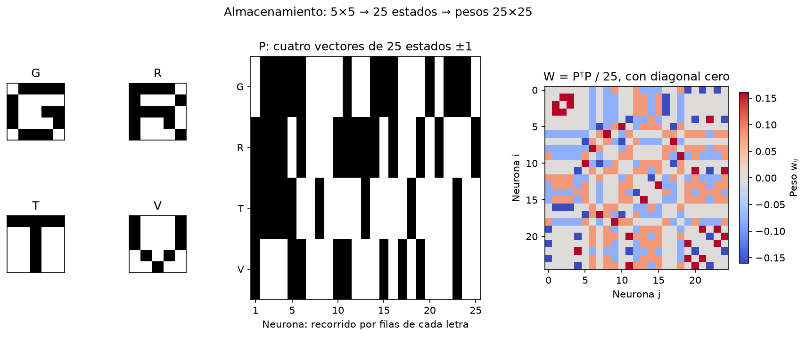

# Ejercicio 2: memoria asociativa

La red utiliza la regla de **Hebb** de la [clase de Hopfield](<../../clases/4.2 - Modelo de Hopfield.pdf>), p. 20. Las [referencias teóricas](../referencias-teoricas.md) indican las fuentes y convenciones.

## Modelo y mediciones

Los estados son −1/+1; los pesos son `W=PᵀP/N`, con diagonal fijada en cero. El campo local determina el siguiente estado; si es cero se conserva el anterior. La tolerancia de redondeo es 1e−9, mucho menor que los campos no nulos de estos datos. No se cambian los pesos durante la recuperación.

Se estudian actualizaciones sincrónicas y asincrónicas en letras. En QR se usa la actualización asincrónica, una neurona por vez. Para este modo, la simetría de pesos y diagonal cero garantizan que `E=−½sᵀWs` no aumente con una actualización; no se atribuye esa garantía al modo sincrónico, que puede entrar en un ciclo de período dos.

Una iteración informada cuenta un barrido que cambió el estado; el barrido final sin cambios comprueba el punto fijo. Se guardan energías por barrido en todas las consultas y por visita de neurona en ejemplos. Convergencia a un punto fijo no significa recuperar el patrón correcto.

## 2.2 Letras 5×5: control del funcionamiento

Se representan 26 letras con 25 estados bipolares y se almacenan cuatro. Se comparan directamente los productos internos de las 14.950 combinaciones de cuatro letras, priorizando menor máximo absoluto y luego menor promedio absoluto. Es una comparación de ortogonalidad, no otra regla de aprendizaje.

El conjunto elegido **G, R, T, V** tiene productos internos fuera de diagonal de valor absoluto **1**, lo más próximo a cero posible con longitud impar 25. Las cuatro letras son puntos fijos. Un conjunto muy correlacionado, **H, M, N, W**, alcanza producto interno absoluto 21 y solo una letra queda fija. La correlación produce interferencia entre los recuerdos.


**Almacenamiento.** Cada letra 5×5 se recorre por filas y forma un vector de **25 estados** (negro +1, blanco −1). Los cuatro vectores forman las filas de una matriz `P` de 4×25. La red almacena su información en `W=PᵀP/25`, de tamaño **25×25**, con diagonal cero. En una consulta se actualizan los 25 estados usando esos pesos; los patrones originales no se copian sobre la consulta.




**Capacidad.** La clase p. 37 da la referencia aproximada `0,15N`: para N=25 resulta 3,75, mientras el enunciado pide almacenar cuatro. Es una orientación para patrones suficientemente poco correlacionados, no una garantía exacta ni un máximo rígido para toda selección de letras. Se muestrean 200 subconjuntos por cantidad almacenada y por semilla, con 30 semillas (6000 muestreos de subconjuntos de cuatro letras). La fracción de letras estables es **75,58% ± 2,04 puntos porcentuales (pp)** y la de conjuntos enteramente estables **48,35% ± 3,57 pp**. La DE se calcula entre los 30 muestreos, no tratando las letras de un subconjunto como réplicas independientes. El conjunto elegido demuestra que cuatro pueden funcionar; el barrido demuestra que no funciona cualquier conjunto.


**Ruido y recuperación.** Se usan 30 semillas, 50 consultas por letra/nivel y cuatro letras: **6000 consultas por condición y nivel**. Se cambia la consulta y el orden asincrónico manteniendo los mismos pesos; la misma consulta se comparte entre modos para comparar. Primero se calcula una tasa por semilla y luego su media y DE entre semillas. La cantidad invertida es entera.

| Bits invertidos | Fracción de 25 | Recuperación asincrónica: media ± DE |
|---|---:|---:|
| 1 | 0,04 | 100,00% ± 0,00 pp |
| 2 | 0,08 | 100,00% ± 0,00 pp |
| 3 | 0,12 | 99,83% ± 0,24 pp |
| 4 | 0,16 | 98,03% ± 1,11 pp |
| 5 | 0,20 | 93,42% ± 2,06 pp |
| 7 | 0,28 | 67,95% ± 3,69 pp |
| 9 | 0,36 | 31,92% ± 2,91 pp |
| 11 | 0,44 | 7,25% ± 2,16 pp |

La recuperación es completa en las consultas observadas de uno y dos bits; con tres bits alcanza 99,83% ± 0,24 pp. En modo sincrónico, el ruido 0,44 produce ciclos en 30,17% ± 4,53 pp de las consultas seleccionadas. En asincrónico no se observan ciclos. Los ciclos no son mínimos estables de energía.


**Estado espurio.** Desde G con 10/25 bits invertidos se alcanzó este punto fijo, diferente de las cuatro letras y sus inversas:

```text
....#
#...#
#..##
##.##
.###.
```

Su energía es **−7,68** y está a seis bits de la letra más cercana; las letras almacenadas tienen energía −10,56. La energía descendió, pero la red terminó en un recuerdo ajeno al catálogo. El espurio mostrado es un ejemplo de la semilla 42. En las 30 semillas con ruido 0,4, la tasa espuria asincrónica es **40,30% ± 6,34 pp**; los patrones inversos tampoco cuentan como recuperación correcta.


Evidencia: `runs/hopfield_letters/recall_by_seed.csv`, `recall_repetitions.csv`, `capacity_by_seed.csv` y `capacity_repetitions.csv`; se conservan ejemplos y trazas de la semilla 42. Los ocho niveles principales suman 192.000 consultas; el nivel adicional 0,4 eleva el total a 216.000.

## 2.1 Los cinco QR de los menús

Se almacenan **los cinco originales suministrados juntos en una red**. Cada imagen contiene 37×37 módulos, que se recorren por filas para formar un vector de **1369 componentes**. Las cinco imágenes coinciden byte por byte con el ZIP original; `inputs.csv` registra sus hashes SHA-256, dimensiones y normas. Negro representa +1 y blanco −1; la red tiene **1369 neuronas**. La conversión de imagen a estados y de vuelta reproduce los originales. Para el lector se agrega únicamente borde blanco y escala por repetición de píxeles; eso no cambia el estado de la memoria.


**Ortogonalidad y almacenamiento.** Los patrones comparten **955/1369 módulos (69,76%)**. La similitud se calcula como **(a·b)/(‖a‖‖b‖)**. Cada vector tiene 1369 valores ±1 y norma **37**; por tanto, el denominador es **37×37=1369**. Entre códigos distintos la similitud media es **0,6701** (rango **0,5763 a 0,8598**). El complemento `1−similitud` promedia **0,3299**, y la fracción de módulos diferentes promedia **0,1649**: son magnitudes distintas. Son patrones fuertemente correlacionados: no se puede aplicar la referencia `0,15N≈205,35` como garantía de que cinco códigos serán memorias estables.


Al guardar los cinco con Hebb, **ninguno es punto fijo**. En el orden principal, vinos, bebidas, postres y especiales, cambiarían respectivamente **71, 91, 225, 225 y 103 módulos**, incluso consultando el original limpio. Esa comprobación permite interpretar el fracaso antes de añadir deterioro.

**Cantidad de códigos almacenados.** Se repitió el almacenamiento para los 31 subconjuntos no vacíos de estos cinco códigos:

| QR guardados juntos | Subconjuntos | Patrones estables por subconjunto |
|---|---:|---:|
| Uno | 5 | 1/1 en todos |
| Dos | 10 | 2/2 en todos |
| Tres | 10 | 0/3 en todos |
| Cuatro | 5 | 0/4 en todos |
| Cinco | 1 | 0/5 |

Hebb sí funciona con QR. El fallo observado corresponde a la interferencia al guardar tres o más de **estos códigos** juntos. La estabilidad de las parejas no garantiza su recuperación para cualquier consulta ruidosa.

Al guardar cada QR en una red separada, las **33.000 consultas** del control se recuperan correctamente (100% ± 0 pp entre las 30 semillas). El nivel nominal 0,5 invierte 684 de 1369 módulos (49,963%), por el redondeo a posiciones enteras.

El control de un patrón también se deduce de la regla. Para un único vector bipolar ξ, `W=(ξξᵀ−I)/N`; si `m=ξᵀs`, entonces `hᵢ=(ξᵢm−sᵢ)/N`. Con menos de la mitad de módulos invertidos, m≥1 para N impar: un módulo correcto tiene campo firmado `(m−1)/N≥0` y permanece correcto; uno incorrecto tiene `(m+1)/N>0` y se corrige. Cada corrección aumenta m. Por eso la actualización asincrónica recupera cualquier consulta de un patrón aislado con menos de la mitad de bits erróneos.

Evidencia: `storage_control.csv` para puntos fijos y `recall_by_seed.csv`/`recall_repetitions.csv` para las 30 semillas, en `runs/hopfield_qr/`. `single_pattern_control.csv` conserva únicamente el ejemplo de 1100 consultas de la semilla 42. Todos usan la misma regla de aprendizaje.

**Consultas y resultado.** Se prueban once niveles de ruido de 0 a 0,5 en pasos de 0,05, 20 consultas por código/nivel y 30 semillas: **33.000 consultas** con los cinco QR juntos y otras 33.000 en el control aislado. Cada nivel reúne 3000 consultas por condición. Las barras muestran media ± DE entre semillas; los pesos son deterministas. Cada consulta invierte exactamente `round(nivel×1369)` posiciones diferentes.

Al almacenar los cinco simultáneamente, la recuperación exacta es **0% ± 0 pp en todos los niveles, incluido cero**. La figura muestra el estado alcanzado desde una consulta.


**Iteraciones y energía.** El máximo es dos barridos que modifican el estado. La media pasa de 1,000 ± 0,000 sin ruido a 1,914 ± 0,072 con nivel 0,5; las estadísticas son entre semillas. La energía asincrónica no aumentó en las mediciones; las trazas por visita de neurona de los ejemplos también lo muestran. Una recuperación rápida y con energía decreciente puede ser completamente incorrecta.


**Lectura QR como comprobación del caso de uso.** Con zxing-cpp 3.1.1 se decodificaron los cinco originales. Las consultas sin ruido se leen correctamente sin usar la red; las salidas de Hebb tienen **0% de lectura de la URL objetivo** en todos los niveles. En las 30 semillas, el lector directo obtiene 0% ± 0 pp con ruido desde 0,05; sin ruido obtiene 100% ± 0 pp. Esto es un resultado para estas inversiones aleatorias de módulos, no una caracterización general de la corrección de errores QR. Leer otro texto no cuenta como éxito.


Si el lector opcional no está instalado, se mantienen las medidas de estabilidad, recuperación, energía e iteraciones; las tasas de decodificación se informan como no disponibles, no como fallos del lector.

**Limitaciones del caso de uso.** La estructura compartida de estos códigos genera fuerte interferencia bajo Hebb. Estar muy por debajo de la capacidad aproximada no resuelve la correlación. La red no conoce menús nuevos ni puede garantizar que una salida corresponda al menú consultado. Una foto real requeriría detectar, alinear y binarizar módulos antes de obtener una matriz comparable; aquí se trabaja con matrices alineadas y daño simulado, como delimita el enunciado. La red que almacena los cinco menús simultáneamente falla con este catálogo. El control individual demuestra que la limitación corresponde al conjunto de memorias y su interferencia, no al formato QR.

Evidencia: `runs/hopfield_qr/inputs.csv`, `pairwise_similarity.csv`, `stored.csv`, `recall_by_seed.csv` y `recall_repetitions.csv`. `queries.csv` y las trazas individuales corresponden a los ejemplos de la semilla 42. Para regenerar ambos experimentos y el lector opcional, ver [README](../../README.md).
